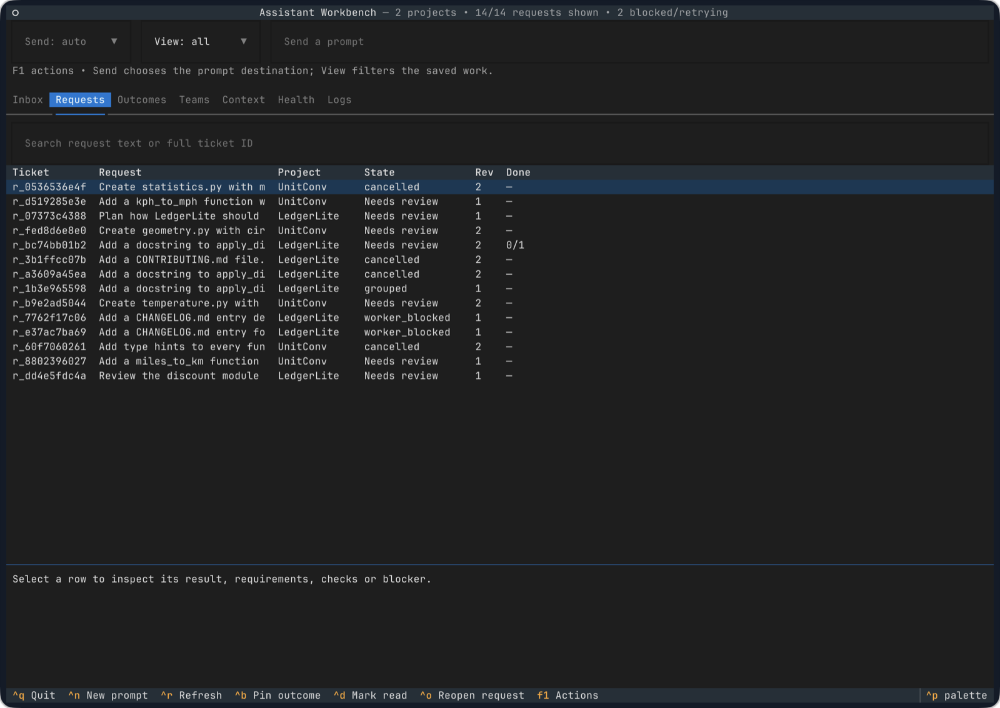
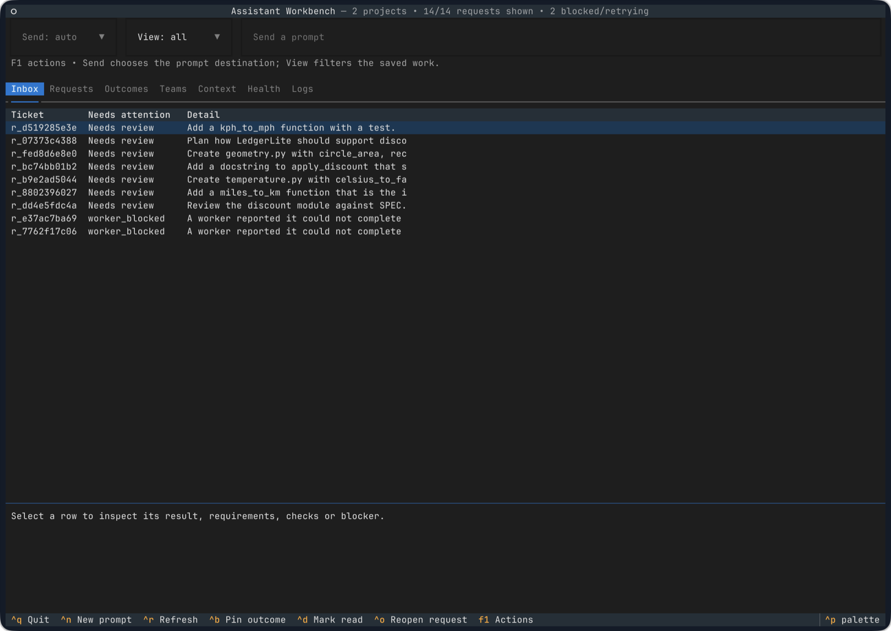
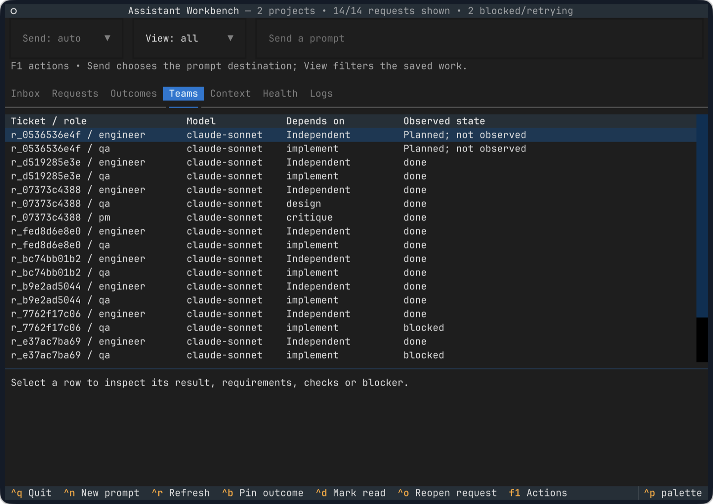
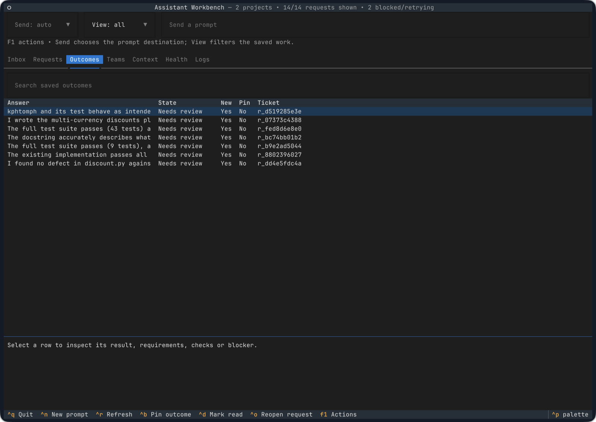
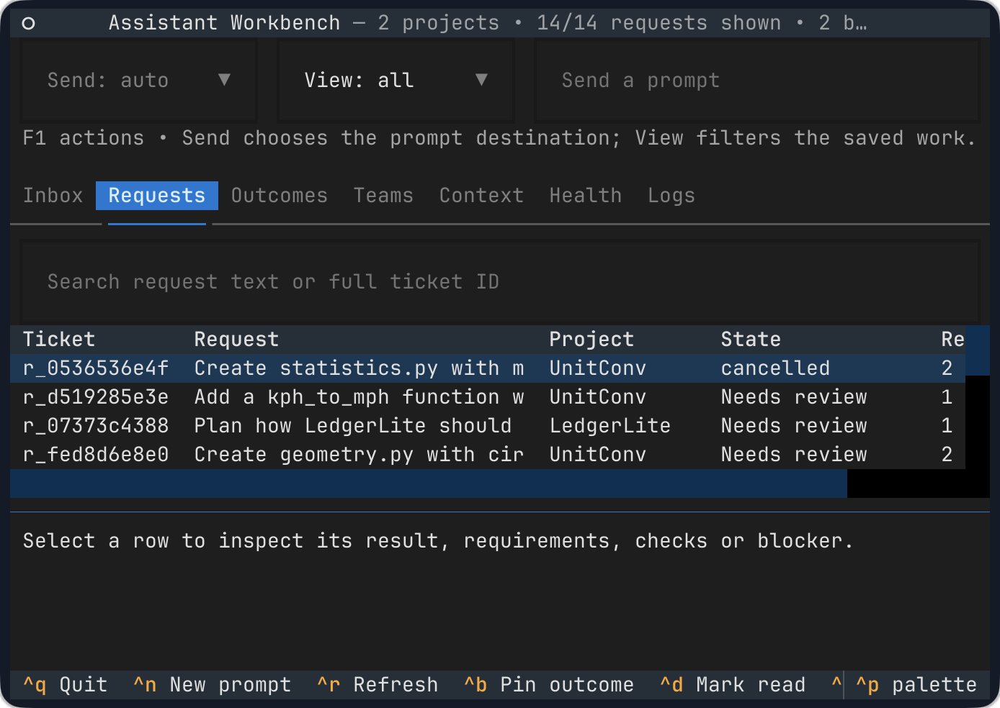
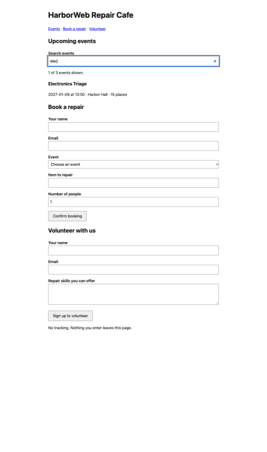

# Assistant Workbench

[](https://github.com/balrajOla/firstmate/actions/workflows/ci.yml)

A terminal workspace for running many requests across many projects with real AI coding agents. You send prompts. The Workbench routes each one to a project, plans a small team (an engineer and a reviewer, or researchers and an editor), and hands the work to a coordinator. The coordinator runs official CLI agents such as Claude Code in isolated git worktrees. Results come back as outcomes you review, separate from the worker logs.

It runs on your machine with the CLI sign-in you already have. It does not turn a subscription into an API key, and it never falls back to paid API access on its own.

**Status: experimental.** All 71 catalogued features are implemented and pass their automated tests. Most have also run live with signed-in agents, but none is release-qualified: human review, a second physical host, a 72-hour soak and a few desktop checks are still open. [What was verified](#what-was-verified) · [Feature register](docs/FEATURES.md)

## In the terminal

Real WezTerm windows on macOS, showing a live state. The requests were run by Claude Code workers through Paperclip.



The attention inbox lists what needs you: outcomes waiting for review, and requests a worker could not finish.



Each request becomes a small team. A design request runs design, critique and plan agents, and a code request runs an engineer and a QA reviewer. The Teams view shows what the coordinator actually observed.



| Outcomes, kept apart from logs | Narrow 80×24 terminal |
|---|---|
|  |  |

A deliverable from the same run: workers built a small repair-café website and later added event search. Each change was checked in a real browser.



## What it does

| Area | What you get |
|---|---|
| Requests | Send prompts while work runs. Each prompt is saved before anything else happens. Requests can be amended (stale edits are refused), grouped, withdrawn, cancelled, reopened and paused per project. |
| Routing | Explicit project links and names, plus a semantic router that uses your signed-in CLI and explains each choice. It continues an existing project, starts a new git-backed project for new work, or files one-off questions under General. Low-confidence choices wait for you. Each worker task carries the project's recent requests and results. |
| Teams | Five workflows (`simple`, `code`, `design`, `report`, `research`) compile into small dependency graphs with roles, a qualified model profile and bounded limits. |
| Coordinators | [Paperclip](https://github.com/paperclipai/paperclip) by default, or Temporal. Workers run the official Claude Code or Codex CLI on the CLI engine, with permission bypass always off and a private branch per task. |
| Review | Worker reports become one unverified outcome per request. A reviewer agent checks the author's work, and nothing counts as accepted until you accept it. |
| Resilience | Work runs in services, so a closed terminal loses nothing. When the internet drops, dispatch stops and running workers ride out short interruptions; when it returns, tasks whose runs failed during the outage are retried. Tasks lost to a restart, reboot or temporary provider failure are retried automatically, a bounded number of times; sign-in problems wait for you. |
| Attention | Requests needing you are listed in one place: delivery failures, worker-reported blocks, and tasks the coordinator stopped (for example, a worker with no sign-in), each with its cause. |
| Context and memory | Original-source archive with hashes, scoped retrieval and coverage, plus optional LCM, Basic Memory, QMD, Docling, Hindsight, OpenViking and Open Notebook. |
| Research and writing | Optional GPT Researcher, Superpowers brainstorming and planning, Elements of Style, Humanizer, Vale and Promptfoo checks. |
| Code execution | Bounded Python, JavaScript, TypeScript and Rust checks with artifact manifests. |
| Terminal | `awb open` starts what is down and reopens the Textual UI where you left it, optionally in a persistent herdr session; Ctrl+Shift+A in WezTerm. Inbox, requests, outcomes, teams, context, health and logs; search, pin, read, reopen and export. |
| Operations | Owned installer with upgrade and rollback, launchd and systemd service definitions, verified backup and restore, uninstall, schedules, a doctor command and evidence-backed qualification. |
| Access | CLI, a loopback HTTP API and MCP tools for other harnesses. |

## Feature status

The [feature register](docs/FEATURES.md) tracks all 71 requirements (PF01–PF71), each with its evidence and remaining work. A [feature-by-feature test plan](docs/FEATURE_TEST_PLAN.md) gives each one a success path, a failure path and an edge case.

| Catalog status | Features | Meaning |
|---|---|---|
| local-tested | 23 | Behavior is covered by automated tests; most were also exercised in the live run |
| partial | 36 | Core behavior works and is tested; the row names what is still open, such as semantic quality, multi-host or OS isolation |
| adapter-tested | 8 | Optional integration ran against the real package or service |
| integrated-not-qualified | 4 | Wired end to end, awaiting production qualification (Temporal, multi-host, runtime selection, auth profiles) |
| qualified | 0 | Needs human review, a second host and the remaining desktop checks |

## What was verified

From a live run on one Mac (macOS 27, Apple silicon) on 9 November 2026. The release was in its own prefix, Paperclip and the bridge ran as launchd services, and the workers were signed-in Claude Code (Sonnet). [Full notes](docs/VERIFICATION.md#live-macos-run-2026-11-09)

| Check | Result |
|---|---|
| Automated tests | 584 unique tests passed, none skipped, including real Temporal, TypeScript, Rust, the installed CLI, Basic Memory, LCM and QMD |
| CI | Ubuntu and macOS, an independently installed wheel and a real Temporal service, on every change |
| All five workflows with real workers | passed |
| Website built by workers, checked in a browser | passed |
| Research report, every quote and number checked against its sources | passed |
| Reviewer found a deliberately planted bug | passed |
| Amend, stale-edit refusal, withdraw and cancel during running work | passed |
| Bridge killed mid-delivery, then restarted | passed; no duplicate work |
| Install, upgrade, rollback, backup, uninstall, restore and reinstall | passed |
| Schedules: missed ticks, restart and overlapping bridges | passed |
| Routing on 45 held-out cases | right project 45/45, right workflow 44/45 |
| Live soak | 10 hours with no lost prompts (a 72-hour run was not done) |

Follow-up checks on the same Mac, 9 to 12 November 2026. [Notes](docs/VERIFICATION.md#follow-up-live-checks-9-12-november-2026)

| Check | Result |
|---|---|
| `install.sh` from scratch into a temporary prefix (path with spaces, its own ports and service labels), then a real task | passed: Paperclip built and onboarded, profiles probed, services installed, task reached review |
| `awb open` with a stopped service, and inside a herdr session | passed |
| Router given work for an existing project, new work and a one-off question | 3 of 3 placed as expected (a new project got its own repository) |
| Connectivity loss: one drill and four real offline periods | each detected and cleared automatically |
| Paperclip restarted in the middle of a run, twice | both requests reached review without help, after the fixes in #46 |

Not verified: Codex workers through Paperclip (Paperclip needs a file-based Codex sign-in), a Pro or Max subscription sign-in (the test machine authenticates Claude through a managed `apiKeyHelper`), a worker run failing during a real outage, a real reboot, mobile builds, two physical hosts, human-calibrated judging, a 72-hour soak, and service start at login.

## Install

One command on macOS or Linux, with no sudo:

```sh
curl -fsSL https://raw.githubusercontent.com/balrajOla/firstmate/main/install.sh | sh
```

Or from a clone: `git clone https://github.com/balrajOla/firstmate.git && cd firstmate && ./install.sh`. Run it again later to upgrade; every step that is already done is skipped.

Before you run it, have git (on macOS, `xcode-select --install`), about 6 GB of free disk space for Paperclip and its build tools, and sign in to at least one agent CLI. The installer uses the sign-in you already have and never reads or copies it:

| Agent | Sign-in that works |
|---|---|
| Claude Code | A Pro or Max subscription (`claude`, then `/login`), the default. For an API key, an `apiKeyHelper` or Bedrock/Vertex, pass `--claude-auth api`. |
| Codex CLI | `codex login` with a ChatGPT plan or an API key. Paperclip reads the sign-in from `~/.codex/auth.json`, so set `cli_auth_credentials_store = "file"` in `~/.codex/config.toml` if your Codex keeps it in the system keychain. |

What it does:

1. Finds Python 3.11 or later, or installs Python 3.12 with a pinned [uv](https://github.com/astral-sh/uv) under the prefix.
2. Installs the Workbench into `~/.local/awb` with its own launcher and links `awb` into `~/.local/bin`.
3. Runs `awb setup`, which:
   - installs Node.js 24, pnpm and rustup under the Workbench home when the machine has no suitable copy (pinned versions, checked against recorded checksums);
   - builds [Paperclip](https://github.com/paperclipai/paperclip) at its pinned commit, onboards it for trusted local use with its telemetry off, creates its company and turns on isolated workspaces;
   - adds a profile for each signed-in agent CLI and checks it with one short prompt;
   - turns on semantic routing when Claude is ready, so each prompt continues the right project, starts a new git-backed project for new work, or goes to General when it is a one-off;
   - installs the Paperclip and bridge services (launchd on macOS, `systemd --user` on Linux) so they start at login;
   - binds Ctrl+Shift+A in WezTerm, if WezTerm is installed.
4. Prints what each step did. Then run `awb open`.

Everything it installs is open source: the Workbench (MIT), Paperclip (MIT), Python, uv, Node.js, pnpm and Rust. It does not install the agent CLIs or any paid service, and it never switches to paid API use by itself.

| Option (after `sh -s --` or `./install.sh`) | Use |
|---|---|
| `--claude-model MODEL`, `--codex-model MODEL` | Models for the profiles (defaults: `sonnet`; Codex's own configured model) |
| `--claude-auth api`, `--codex-auth api` | Use an API key or helper instead of a subscription |
| `--no-probe` | Add profiles without the one-prompt check |
| `--no-paperclip` | Keep a coordinator you already configured |
| `--label-prefix P --paperclip-port N --bridge-port N` | A second installation beside the first; give its state its own `--home` |
| `--no-terminal` | Leave the WezTerm configuration alone |

[Full setup guide](docs/SETUP.md), covering manual installation, profiles, grants, routing and services · [Optional local services](docs/LOCAL_SERVICES.md) · [Temporal and remote workers](docs/RUNTIME_BACKENDS.md) · [CLI, HTTP and MCP reference](docs/API.md)

## Use

```sh
awb open
```

`awb open` is the one command to remember. It starts the coordinator and the bridge if they are down, waits until they are healthy, and opens the terminal UI on the tab, filters and row you left. Type prompts there. Work runs in background services, so closing the window or the UI loses nothing; run `awb open` again to pick up where you were. With `--session herdr`, the UI itself also survives a closed terminal in a persistent [herdr](https://herdr.dev) session. [How it works](docs/SETUP.md#one-command-awb-open)

From the shell:

```sh
awb project add "My site" --repository ~/code/my-site
awb submit "Add a contact form with validation and tests" --project "My site"
awb terminal install --config-file ~/.wezterm.lua --executable "$(command -v awb)"   # Ctrl+Shift+A runs awb open in WezTerm
```

Amend a request with `awb submit "…" --reply-to REQUEST_ID --expected-revision N`. Cancel it with `awb request '{"action":"request.cancel","args":{"request_id":"…"}}'`.

## Operate

| Task | Command |
|---|---|
| Run as a service (macOS) | `awb service launchd --executable "$(command -v awb)" > ~/Library/LaunchAgents/com.assistant-workbench.bridge.plist`, then `launchctl bootstrap gui/$(id -u) <plist>` |
| Stop the service | `launchctl bootout gui/$(id -u)/com.assistant-workbench.bridge` |
| Restart after an upgrade | `launchctl kickstart -k gui/$(id -u)/com.assistant-workbench.bridge` |
| Linux service | `awb service systemd --executable "$(command -v awb)"` |
| Second home on one machine | add `--label` and `--port` to `awb service` |
| Upgrade | `git pull && awb install --source . --prefix ~/.local/awb` |
| Roll back | `awb rollback --prefix ~/.local/awb` |
| Back up and restore state | `awb backup /path/new-backup` and `awb restore /path/new-backup /path/new-state` |
| Uninstall the launcher | `awb uninstall --prefix ~/.local/awb` (state and release copies are kept) |
| Optional components | `awb deps list`, `awb deps install hindsight openviking …` |
| Health and qualification | `awb doctor`, `awb qualify --output report.json` |

## Reproduce the checks

```sh
.venv/bin/python -m pip install -r requirements-dev.lock
.venv/bin/python scripts/evaluate_feature_coverage.py --write-run-metadata run-metadata.json
.venv/bin/python -m pytest -q --junitxml=test-results.xml
.venv/bin/python scripts/evaluate_feature_coverage.py --junit test-results.xml \
  --run-metadata run-metadata.json --output feature-coverage.json
```

The evaluator exits with 3 until every feature has live, human and target-desktop evidence. That is not a test failure. Some tests skip unless you point them at real tools (Temporal, TypeScript, Rust, Basic Memory, LCM, QMD); the skip message names the variable to set.

## Documentation

[Setup](docs/SETUP.md) · [Architecture](docs/ARCHITECTURE.md) · [Features](docs/FEATURES.md) · [Verification](docs/VERIFICATION.md) · [Implementation status](docs/IMPLEMENTATION_STATUS.md) · [Local services](docs/LOCAL_SERVICES.md) · [Runtime backends](docs/RUNTIME_BACKENDS.md) · [Context backends](docs/CONTEXT_BACKENDS.md) · [Memory limits](docs/MEMORY_INTEGRATION_LIMITS.md) · [Execution packs](docs/EXECUTION_PACKS.md) · [Migration](docs/MIGRATION.md) · [Terminal scenarios](docs/TERMINAL_SCENARIOS.md) · [API](docs/API.md)
