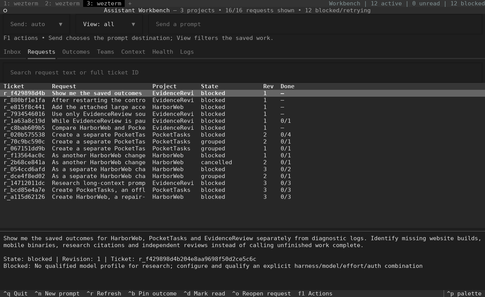
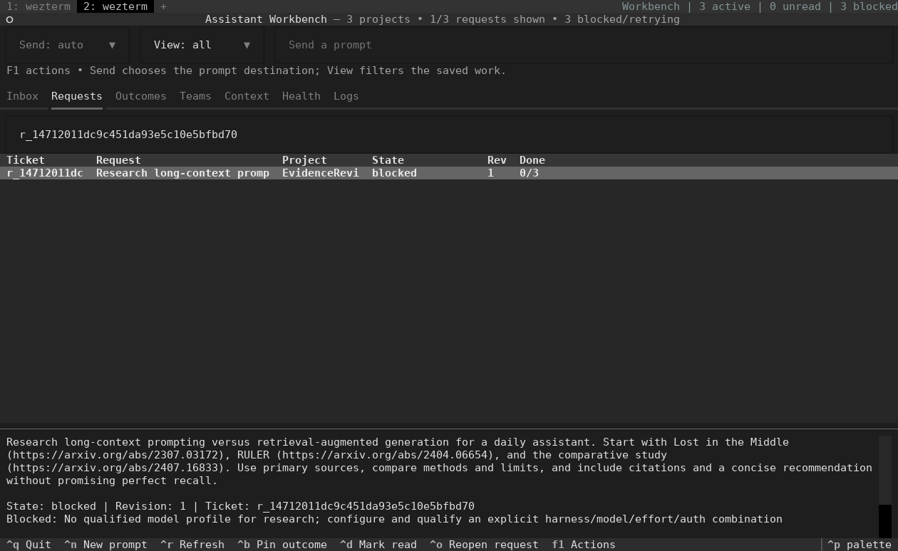

# Assistant Workbench

[](https://github.com/balrajOla/firstmate/actions/workflows/ci.yml)

A terminal workspace for parallel requests, project context, code execution and reviewed results. It keeps outcomes separate from worker logs. Choose **Paperclip or Temporal** to coordinate agents; use the CLI, local HTTP service or MCP from your harness. Olympus is not a runtime dependency.

**Experimental.** The application has passing local coverage for all 71 catalogued features. Full release qualification remains blocked: the cloud Codex canary did not complete, so real agent teams and generated website/mobile/research outcomes are not certified.

[All 71 features](docs/FEATURES.md) · [Feature-by-feature test plan](docs/FEATURE_TEST_PLAN.md) · [Architecture](docs/ARCHITECTURE.md) · [Remaining gaps](docs/IMPLEMENTATION_STATUS.md)

## What actually ran

Recorded on **8 November 2026**. [Exact results and source fingerprint](docs/evidence/cloud-run/verification.json) · [All 467 cases](docs/evidence/cloud-run/TEST_CASES.md) · [JUnit](docs/evidence/cloud-run/all-tests.xml) · [Raw test log](docs/evidence/cloud-run/all-tests.log)

| Check | Observed result |
|---|---|
| Combined tests, including an independently installed wheel | **467 passed; 0 failed; 0 skipped** in 174.85 seconds |
| Three-project workload | **30/30 control scenarios passed**, saving 22 prompts plus control actions, amendments and receipts |
| Native WezTerm | **37 actual screenshots**, including all 30 checkpoints; the plugin shortcut opened another real Workbench tab |
| Temporal | Actual development server, SDK, task queues and HTTP worker control; DAG, cancellation, restart and checkpoint tests used explicitly labelled activities/process fixtures |
| Language execution | Real Python, Node, TypeScript and Rust commands; positive and seeded failure cases, cancellation and artifact checks |
| Memory packages | Real Basic Memory revision conflicts, LCM capture/project isolation/hook-file merge and QMD CPU vector retrieval with local models |
| Codex CLI | Installed **0.167.0**; login status reported ChatGPT, but read-only canaries returned no model events. Startup diagnostics included a plugin endpoint authentication error |
| Feature accounting | All **71 have passing mapped automated coverage**. All retain open full-feature evidence gates; no claim of exhaustive qualification |

The [Codex diagnostic summary](docs/evidence/cloud-run/codex-canary.json) distinguishes the observed authentication error from the unresolved cause of the startup timeout. No credentials, raw provider debug logs or authentication files are published.

## The terminal, during the run

These are actual WezTerm windows on a cloud Linux display. The blocked states are real: a queued request does not become a completed product just because the UI works.





[View all 37 native screenshots](docs/evidence/cloud-run/GALLERY.md) · [Image hashes and observations](docs/evidence/cloud-run/native-manifest.json) · [30 instructions](evals/scenarios-30.json) · [Scenario results](docs/evidence/cloud-run/scenario-results.json)

The workload interleaves a repair-cafe website, an offline mobile task app and a sourced research report. It adds features, introduces conflicting requirements, groups related requests, rejects stale edits, cancels/reopens work, pauses a project and checks large-context retrieval. **These controls passed; the three product deliveries remain blocked.** The screenshots do not show fabricated website, mobile or research completion.

## Features

| Area | Available behavior | Important boundary |
|---|---|---|
| Requests and projects | Concurrent intake, retry keys, routing explanations, grouping, revisions, cancellation, reopen, pause/resume and separate deliverables | Routing is an explainable lexical policy; ambiguous work needs review |
| Context | Original-source archive, hashes, scoped retrieval, coverage, contradictions and bounded packets | Storage can grow; a model still has a finite context window |
| Memory | LCM, Basic Memory, QMD, plus scoped Hindsight/OpenViking ingest, recall, read, delete and reconcile | Each service needs explicit configuration; generated summaries and live hook capture require their own evaluation |
| Teams | Role/dependency plans, explicit model/effort profiles, durable dispatch, messages, host queues, capacity and lease fencing | Live model teamwork and physical multi-host deployment remain unqualified |
| Long jobs | Checkpoints, explicit fresh-session handoff, cumulative budgets, stop acknowledgement and uncertain-effect reconciliation | No automatic detector for every provider's context-window exhaustion |
| Code and artifacts | Reviewed command plans; Python/JavaScript/TypeScript/Rust execution; resource bounds, cancellation, hashes, web/mobile/research manifests | Mechanical checks do not prove a usable website, device-tested mobile app or correct research |
| Writing and review | Brainstorming/planning procedures, concise-writing checks, citations, independent deliverables and multi-outcome HTML/Markdown exports | Reviewer identities are caller supplied; no zero-hallucination guarantee |
| Terminal | Searchable tickets, Send/View separation, persistent outcomes, team states, fleet capacity, status counts and keyboard controls | The cloud run does not qualify the user's fonts, OS services, sleep/reboot or customized desktop |
| Usage | Provider-reported token counters, cache semantics, known/unknown coverage and capacity reservations | Costs, subscription balance and unavailable resource telemetry remain unknown |
| Installation and recovery | Owned launcher, private environment, project-scoped configuration, migration inventory, verified backup/restore and preserved workspace artifacts | The user's machine has not been modified by these cloud tests |
| Harness access | CLI, loopback operator API, host-scoped worker API and **21 typed MCP tools** | Official CLI authentication and actual profile qualification are required |
| Evaluation | 71 explicit feature scenarios, 30-instruction workload, source-bound JUnit accounting and native capture tooling | Fixtures, skipped checks and missing live evidence cannot silently qualify a release |

Named procedures and integrations include **Superpowers, Elements of Style, Humanizer, Vale, Promptfoo, Docling, Open Notebook and GPT Researcher**. Installation, activation and observed success are separate states. [Compatibility](docs/COMPATIBILITY.md) · [Memory contracts](docs/MEMORY_INTEGRATION_LIMITS.md) · [Context backends](docs/CONTEXT_BACKENDS.md) · [Local service stack](docs/LOCAL_SERVICES.md) · [Execution packs](docs/EXECUTION_PACKS.md)

## Install

Use Python 3.11 or later; the retained test run used Python 3.12.

```sh
git clone --branch main https://github.com/balrajOla/firstmate.git assistant-workbench
cd assistant-workbench
python3 -m venv .venv
.venv/bin/python -m pip install -c requirements-runtime.lock '.[tui]'
.venv/bin/awb init
.venv/bin/awb doctor
```

For the optional Temporal backend:

```sh
.venv/bin/python -m pip install -r requirements-temporal.lock
```

Then configure **one** coordinator and an explicit model profile. A subscription setup uses the official Codex or Claude CLI's sign-in; it does not need an API key merely to use that CLI. Run `profile.probe` before admitting work. A failed probe revokes old qualification. Components requiring their own API/local inference remain disabled until configured; there is no silent paid-provider fallback.

[Step-by-step setup and WezTerm plugin](docs/SETUP.md) · [Temporal and remote workers](docs/RUNTIME_BACKENDS.md) · [CLI/HTTP/MCP reference](docs/API.md)

For an existing Olympus installation, use the [replacement prompt](docs/INSTALL_AND_REPLACE_OLYMPUS.md). It preserves custom changes, verifies the replacement and retires only the identified installation. Cloud testing does not uninstall software on another machine.

## Reproduce the checks

```sh
.venv/bin/python -m pip install -r requirements-dev.lock
.venv/bin/python scripts/build_feature_register.py
.venv/bin/python scripts/evaluate_feature_coverage.py --write-run-metadata run-metadata.json
.venv/bin/python -m pytest -q --junitxml=test-results.xml
.venv/bin/python scripts/evaluate_feature_coverage.py \
  --junit test-results.xml --run-metadata run-metadata.json \
  --output feature-coverage.json
```

The last command returns **3** while full-feature evidence is missing. That is distinct from a failing automated test. A default environment may skip optional package/service tests: use the prerequisites in the [feature plan](docs/FEATURE_TEST_PLAN.md), [memory guide](docs/MEMORY_INTEGRATION_LIMITS.md) and [runtime guide](docs/RUNTIME_BACKENDS.md) to reproduce the retained no-skip run.

Run `scripts/run_scenarios.py --help` for the isolated 30-instruction workload and `scripts/capture_wezterm_scenarios.py --help` (Linux/Xvfb) or `scripts/capture_wezterm_macos.py --help` (macOS WezTerm) for actual native captures. Neither script invents agent outcomes. CI checks Ubuntu/macOS, an independently installed package, a real Temporal development service and missing-evidence refusal.
