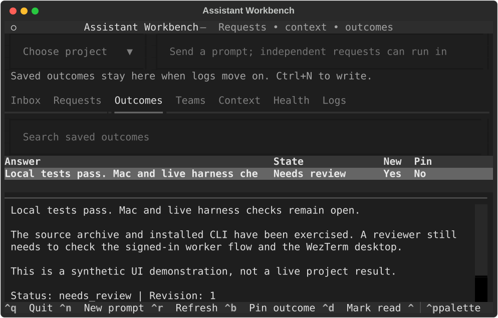

# Assistant Workbench

A terminal workspace for durable prompts, scoped context and reviewable outcomes, with Paperclip as the agent execution coordinator. This branch is a fresh replacement for the Olympus application. It does not run an Olympus service, scheduler or UI.

**Status: experimental implementation, not a fully qualified replacement release.** The local core and adapters have executable tests. Live Claude/Codex teams, the actual Mac WezTerm GUI, production research providers and a 72-hour soak remain release gates. Do not remove a working installation based on fixture tests. See [implementation status](docs/IMPLEMENTATION_STATUS.md), [verification](docs/VERIFICATION.md) and the complete [71-feature register](docs/FEATURES.md).

## What you can use

- Save concurrent prompts, preserve originals, route explicit project references, amend with revision checks, group related requests and track separate deliverables.
- Archive originals, search project-scoped evidence, track corpus coverage, preserve conflicting assertions, assemble bounded context packets and recall saved prompts after restart.
- Compile role/dependency plans, select qualified model profiles, deliver issues through an idempotent outbox, exchange durable messages and request bounded fresh-context handoffs.
- Keep outcomes, review evidence, read/pin markers and exported reports outside worker scrollback.
- Install a thin WezTerm module that launches the terminal app and optionally displays local status counts.
- Connect LCM, Basic Memory, QMD, Docling, Open Notebook, GPT Researcher, Vale and Promptfoo through explicit adapters. Activate pinned Superpowers, Elements of Style and Humanizer procedures.
- Back up, restore and replace an identified Olympus installation while preserving local code changes, Git history, credentials and user projects.

Features have different evidence levels. An adapter, a successful local-package test and a successful live model workflow are different results. [FEATURES.md](docs/FEATURES.md) records those differences rather than treating every row as complete.



## Install the application

Python 3.11+ is required. The installer uses a private virtual environment and an owned launcher; it does not overwrite another `awb` executable.

```sh
git clone --branch codex/assistant-workbench https://github.com/balrajOla/firstmate.git assistant-workbench
cd assistant-workbench
python3 -m venv .bootstrap
.bootstrap/bin/python -m pip install -c requirements-dev.lock -e '.[test]'
.bootstrap/bin/awb install --source . --prefix "$HOME/.local"
"$HOME/.local/bin/awb" init
"$HOME/.local/bin/awb" project add MyProject --repository /absolute/path/to/project
"$HOME/.local/bin/awb" tui
```

Installing Workbench alone gives you intake, context, outcomes, exports and the terminal app. Agent execution additionally requires a configured Paperclip instance and a qualified model profile. `awb doctor` reports the distinction. Installation does not activate background services, schedules or paid providers.

The optional runtime dependency pins are in `src/assistant_workbench/assets/dependencies.json`. Python runtime and development dependency versions are recorded in `requirements-*.lock`. These are resolved version constraints, not universal binary hashes or a guarantee that all upstream dependencies are reproducible on every platform.

## Connect a harness

[SETUP.md](docs/SETUP.md) covers Paperclip, official CLI sign-in, model/effort profiles, optional integrations, MCP and WezTerm. The default state directory is `~/.local/share/assistant-workbench`; use `awb --home PATH` or `AWB_HOME` for an isolated instance.

```sh
awb submit 'Investigate the failing build' --project MyProject --key my-request-1
awb request '{"action":"capabilities.list"}'
awb doctor
awb serve
```

The same client key retries the same submission. A new key means new intent, even if the wording is identical. Explicit replies require the current revision. Ambiguous project routing leaves a visible request needing assignment.

For a harness with an MCP stdio configuration, register the absolute installed `awb` executable with arguments `--home`, your state path, `mcp`. This exposes a small local tool surface; it is not a universal integration with every host's hooks or subagent implementation.

## Replace Olympus on an existing Mac

Use [INSTALL_AND_REPLACE_OLYMPUS.md](docs/INSTALL_AND_REPLACE_OLYMPUS.md) as the installation agent prompt. It accounts for a customized old checkout and makes the new runtime independent. The software retirement command refuses cutover without current target-machine evidence. Recovery copies remain private; they are not an active Olympus dependency.

## Develop and verify

```sh
python3 -m venv .venv
.venv/bin/python -m pip install -r requirements-dev.lock
.venv/bin/python -m pip install -e .
.venv/bin/pytest -q
.venv/bin/python -m build
```

An installed-artifact scenario is enabled with `AWB_INSTALLED_CLI=/absolute/path/to/awb`. Real dependency probes are separate scripts under `scripts/`; they use synthetic data and do not count as live model tests. Fixture-based Paperclip tests are explicitly named as fixtures.

See [architecture](docs/ARCHITECTURE.md), [operator API](docs/API.md), [authentication compatibility](docs/COMPATIBILITY.md), [migration](docs/MIGRATION.md), [verification](docs/VERIFICATION.md), and [security boundaries](SECURITY.md).

## Honest limits

Storage can grow beyond a model's context window; each model call still has a finite budget. Full-corpus coverage, semantic correctness and zero hallucinations cannot be guaranteed by a summarizer or an LLM judge. Source checks, explicit omissions, independent review and measured evaluations reduce errors and make them visible.

This release uses one local trust domain. Project filters and Git worktrees are not an OS sandbox. Remote multi-host operation and the optional OpenViking, Hindsight and Temporal backends are not implemented. Do not deploy this as a multi-tenant service.
