# Assistant Workbench

[](https://github.com/balrajOla/firstmate/actions/workflows/ci.yml)

A terminal workspace that saves your requests, keeps project context separate, and gives each request a lasting outcome. Paperclip coordinates agent execution; Workbench provides intake, context, checkpoints, review and the terminal view. This application replaces the Olympus codebase and has no Olympus runtime dependency.

**Experimental.** The local application and installed package pass the checks below. Live agent teams, real context rollovers and the WezTerm desktop still need target-machine qualification. The [71-feature register](docs/FEATURES.md) distinguishes completed local work, partial features, adapters and unimplemented options.

## Latest test results

Retested on **7 November 2026** against application commit `a55dadc6df99d`. These images render captured JUnit and JSON results; they are not screenshots of a live WezTerm desktop. [Exact results](docs/evidence/verification.json) · [Every test case](docs/evidence/TEST_CASES.md) · [Raw test log](docs/evidence/retest/pytest.log) · [JUnit](docs/evidence/pytest.xml)

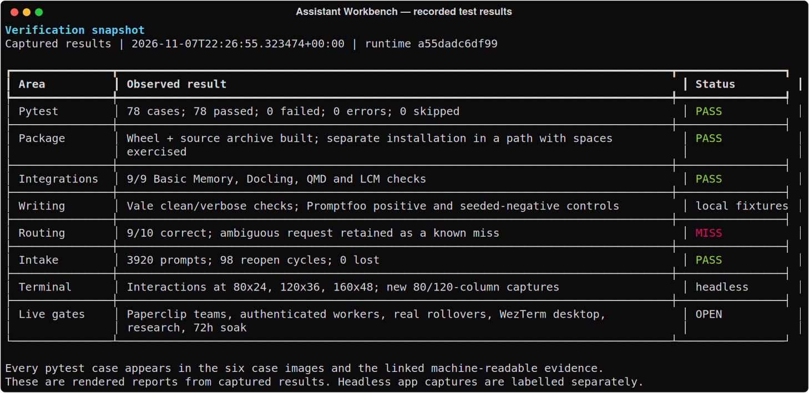

| Check | Observed result |
|---|---|
| Core, interfaces and independently installed package | **78 passed, 0 failed, 0 skipped**; 6.98 seconds |
| Package build and installation | Wheel and source archive built; independent environment in a path containing spaces exercised |
| Basic Memory, Docling, QMD and LCM | **9/9 passed** using real local packages and synthetic inputs; LCM summarization disabled |
| Writing checks | Vale: 0 clean-fixture alerts, 3 seeded warnings. Promptfoo: positive control passed; seeded false claim correctly rejected |
| Request routing demonstration | **9/10 correct**; “Report the architecture review” incorrectly selects design |
| Durable intake | **3,920 prompts**, 98 reopen cycles, **0 lost** in 30.1 seconds |
| Terminal interactions | Headless tests at 80×24, 120×36 and 160×48, including a worker-log flood |
| Missing-evidence boundary | Qualification correctly refused with exit code 3 |

GitHub Actions runs the core suite and an independently installed wheel on **Ubuntu and macOS**, and retains separate JUnit artifacts for both. The badge links to current CI. A macOS shell job does not qualify the WezTerm desktop.

### Screenshots of every executed test case

The six captures below contain all **78 JUnit case IDs**, their results and durations. The [screenshot manifest](docs/evidence/screenshot-manifest.json) maps each case to an image and records file hashes. The renderer checks that no case is omitted or duplicated and that the summary matches JUnit.

<details>
<summary>Show all 78 pytest cases — six captures</summary>

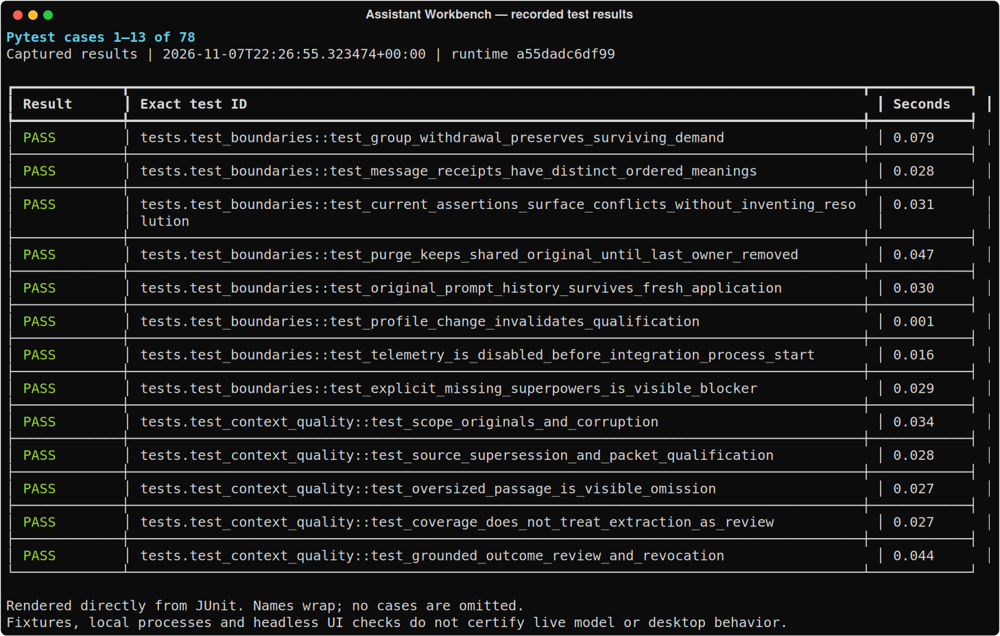
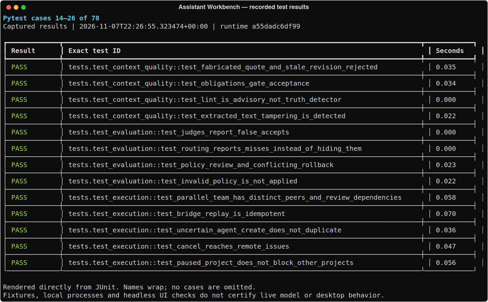
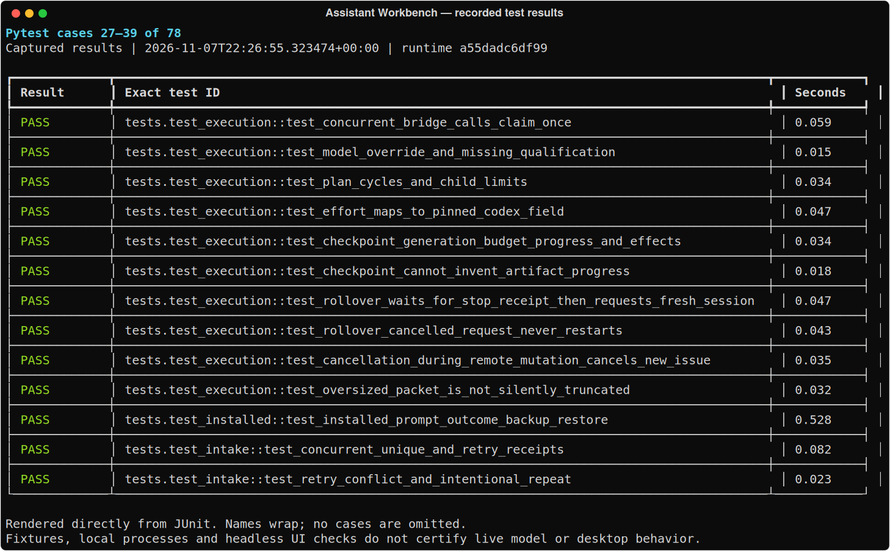
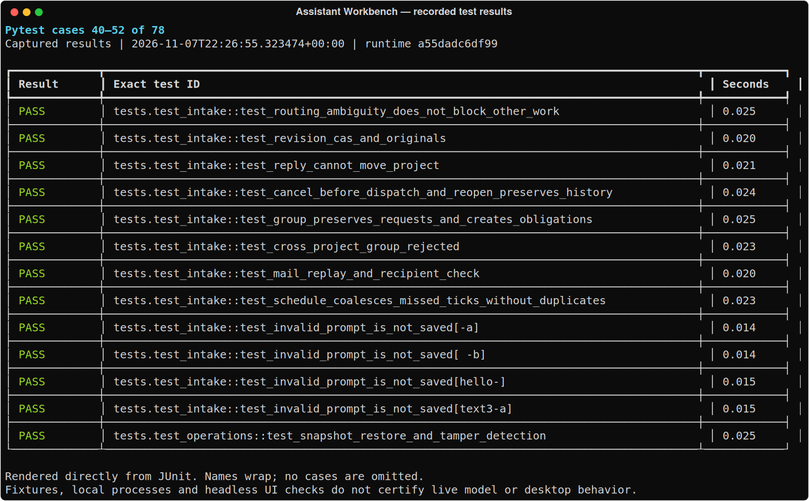
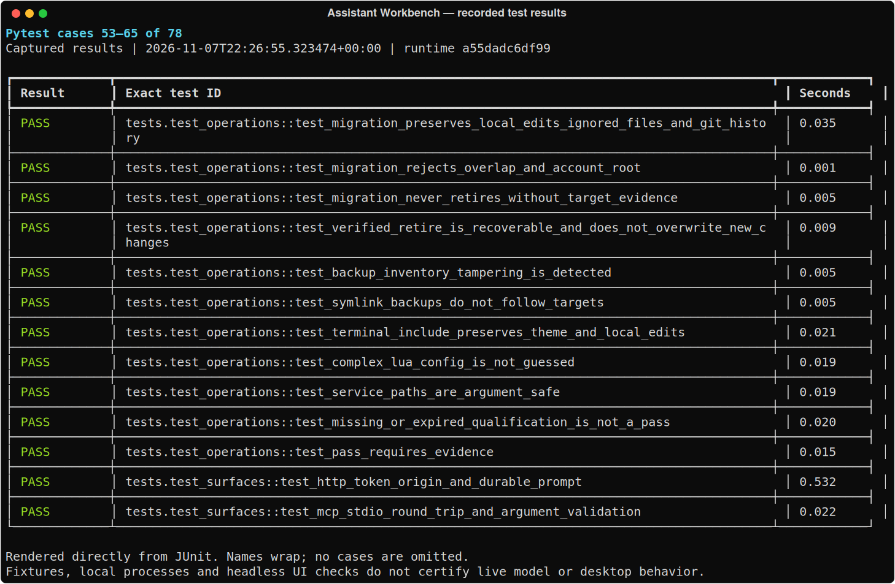
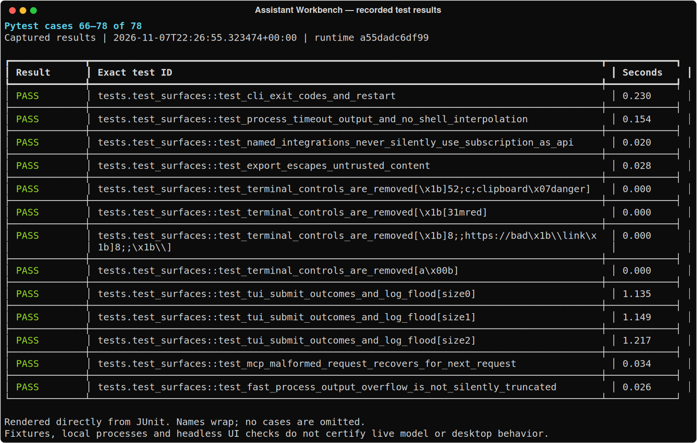

</details>

<details>
<summary>Show local integration, writing, intake and qualification checks</summary>

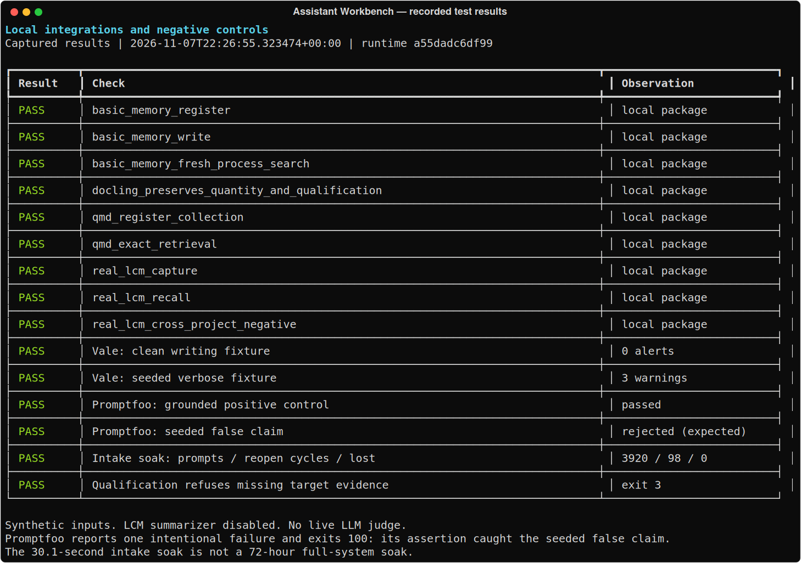

Promptfoo intentionally reports one failing fixture and exits 100: the assertion rejects a seeded false claim. This is a successful negative control, not a live model quality score. [Promptfoo output](docs/evidence/retest/promptfoo.log) · [Vale output](docs/evidence/retest/vale-verbose.log) · [Intake results](docs/evidence/retest/intake-soak.json)

</details>

<details>
<summary>Show all 10 routing examples, including the miss</summary>

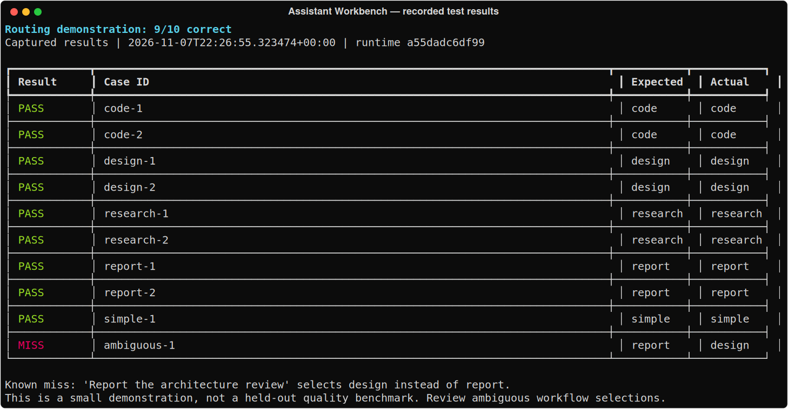

The current keyword policy needs review for ambiguous requests. This small demonstration is not a held-out quality benchmark. [Inputs](evals/routing.json) · [Results](docs/evidence/retest/routing.json)

</details>

## Terminal view

These are fresh captures of the actual Textual application in headless mode, displaying synthetic demonstration data. Outcomes have their own view so worker logs do not bury them.

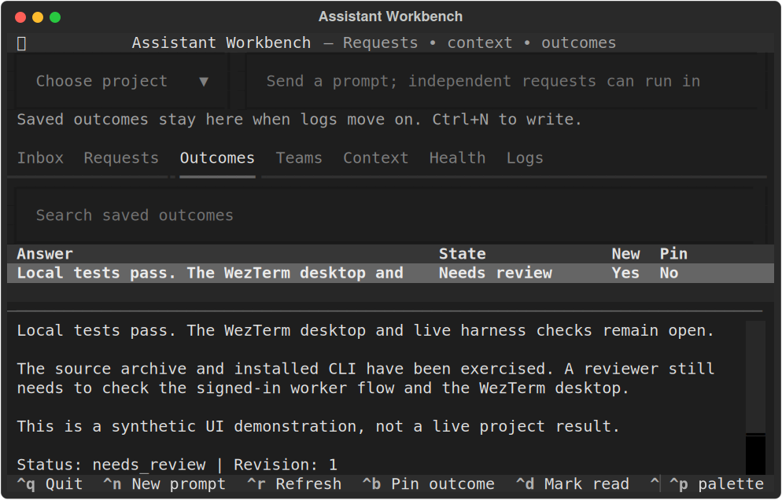

<details>
<summary>Show the 120-column view</summary>

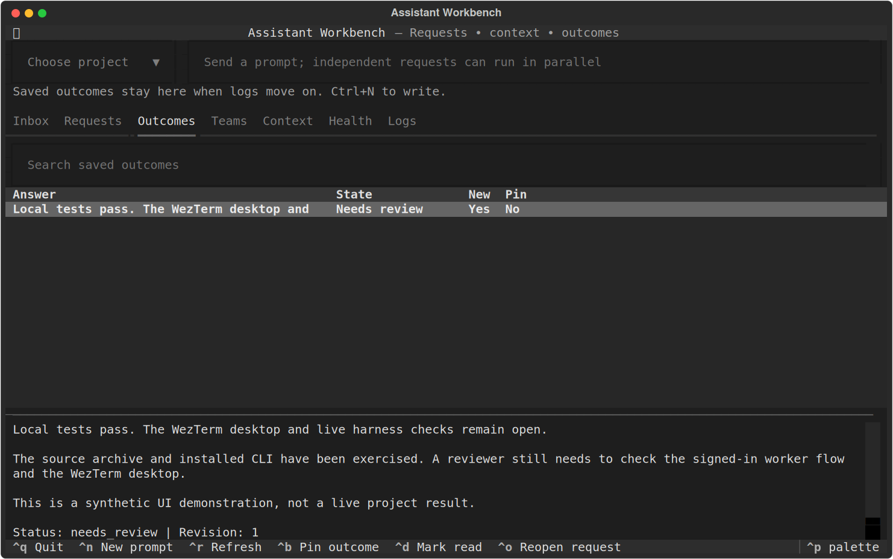

</details>

The WezTerm module opens this app in a terminal tab and can show status counts. See [WezTerm setup](docs/SETUP.md#wezterm) for installation and shortcuts.

## What it provides

| Area | Available behavior | Evidence and limits |
|---|---|---|
| Requests and projects | Concurrent intake, original prompts, retry keys, grouping, amendments, cancellation and distinct deliverables | Local persistence/concurrency tests; semantic routing remains partial |
| Context and memory | Scoped source archive, retrieval, citations, conflicts, coverage and bounded context packets | Local checks and selected real memory adapters; finite model context still applies |
| Agents and long jobs | Role/dependency plans, model/effort profiles, durable delivery, messages and bounded fresh-session handoffs through Paperclip | Coordinator contract fixtures; genuine teams and repeated model-session recovery remain unqualified |
| Clear outcomes | Reviewable results, source checks, read/pin markers, Markdown/HTML exports and writing procedures | Local checks; factual correctness and zero hallucinations cannot be guaranteed |
| Harness access | CLI, local operator API and MCP; subscription/API/local profile configuration | Requires an installed, authenticated and qualified harness; no silent paid-provider fallback |
| Integrations | LCM, Basic Memory, QMD, Docling, Open Notebook, GPT Researcher, Vale and Promptfoo adapters; pinned Superpowers, Elements of Style and Humanizer procedures | Installation, activation and live success are separate states; research generation is unqualified |
| Installation and recovery | Private environment, owned launcher, backups, customized-install migration, Git-history preservation and restore | Local fixtures and installed-package checks; the user's existing Mac installation has not been changed |

[Complete feature list](docs/FEATURES.md) · [Architecture diagrams](docs/ARCHITECTURE.md) · [Implementation status](docs/IMPLEMENTATION_STATUS.md) · [Authentication compatibility](docs/COMPATIBILITY.md)

## Install from main

Python 3.11+ is required; the test matrix uses Python 3.12.

```sh
git clone --branch main https://github.com/balrajOla/firstmate.git assistant-workbench
cd assistant-workbench
python3 -m venv .bootstrap
.bootstrap/bin/python -m pip install -c requirements-dev.lock -e '.[test]'
.bootstrap/bin/awb install --source . --prefix "$HOME/.local"
"$HOME/.local/bin/awb" init
"$HOME/.local/bin/awb" project add MyProject --repository /absolute/path/to/project
"$HOME/.local/bin/awb" tui
```

This installs the local workspace. Agent execution additionally needs Paperclip and a qualified model profile. Run `awb doctor`, then follow [setup](docs/SETUP.md). To replace a customized Olympus installation, use the complete [installation and replacement prompt](docs/INSTALL_AND_REPLACE_OLYMPUS.md); it preserves recoverable copies and requires current machine evidence before retirement.

```sh
awb submit 'Investigate the failing build' --project MyProject --key request-1
awb snapshot
awb doctor
```

The same request key retries one submission; a new key creates new intent. Ambiguous project assignments remain visible. State defaults to `~/.local/share/assistant-workbench`; use `awb --home PATH` for an isolated instance.

## Reproduce the checks

```sh
python3 -m venv .venv
.venv/bin/python -m pip install -r requirements-dev.lock
.venv/bin/python -m pip install -e .
.venv/bin/python -m build
python3 -m venv '/tmp/awb installed release'
'/tmp/awb installed release/bin/python' -m pip install \
  -c requirements-runtime.lock dist/*.whl textual==8.2.8
AWB_INSTALLED_CLI='/tmp/awb installed release/bin/awb' \
  .venv/bin/pytest -vv --junitxml=test-results.xml
```

Without `AWB_INSTALLED_CLI`, the independent-install scenario is explicitly skipped. Real dependency probes, screenshot regeneration and recorded commands are documented in [the retest record](docs/evidence/retest/README.md). Full release criteria are in [verification](docs/VERIFICATION.md).

## Still open

Live Paperclip startup was blocked by this environment's PostgreSQL/user restrictions. Authenticated Claude/Codex teams, five genuine fresh-context sessions, a real WezTerm desktop, research-provider generation, human-calibrated judges and a 72-hour mixed-workload soak have not been qualified. Hindsight, OpenViking, Temporal and multi-host backends are optional and unimplemented.

This runs in one local trust domain; project filters are not an operating-system sandbox. See [security](SECURITY.md), [migration](docs/MIGRATION.md) and the [operator API](docs/API.md) before deployment.
