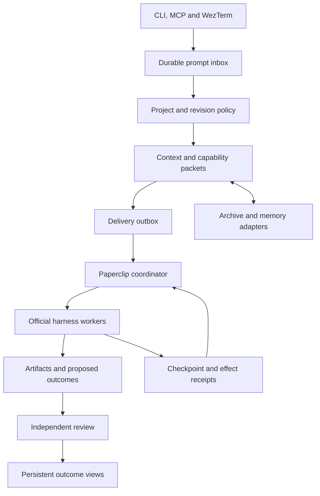
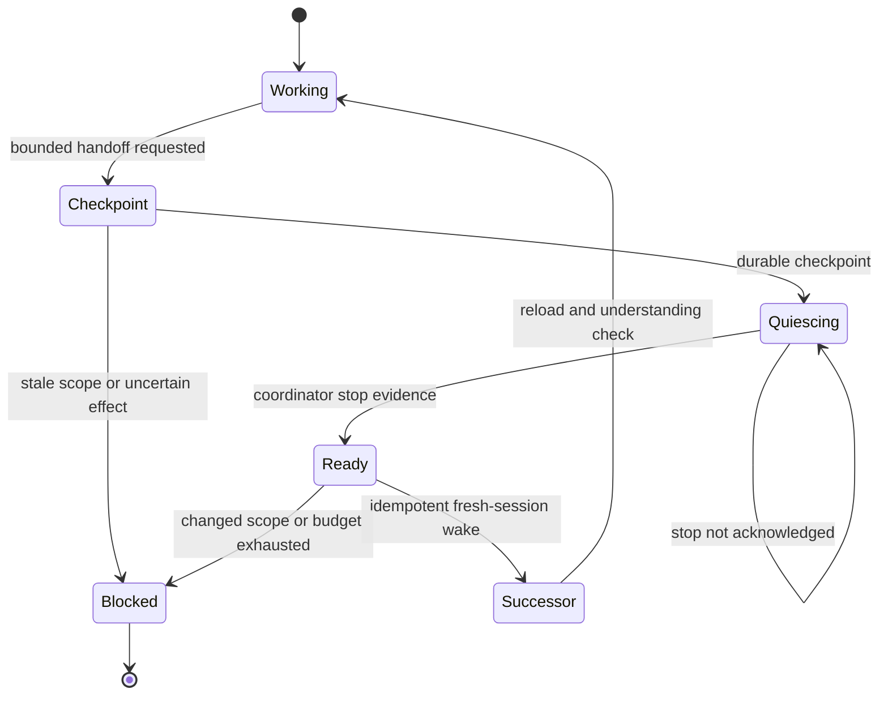

# Architecture

The replacement keeps execution, durable intent and presentation separate. Paperclip is the only component that schedules agent workers. Workbench never launches a competing Ralph or multi-agent daemon.

## Ownership

| Concern | Owner | Durable representation |
|---|---|---|
| Original intent, revision and grouping | Workbench | SQLite prompts, requests, links, obligations |
| Agent ownership, issue execution and workspaces | Paperclip | Paperclip projects, agents, issues, runs |
| Delivery/reconciliation | Workbench bridge | Outbox, leases, operation keys, agent creation journal |
| Evidence | Workbench plus optional index adapters | Original byte archive, sources, coverage, provenance |
| History and curated knowledge | LCM and Basic Memory adapters | Explicit project bindings; no unrelated chat-directory scan |
| Search acceleration | Optional QMD | Named collection per project |
| Fresh-context handoff | Workbench protocol through Paperclip | Checkpoint generations, parent budget, stop evidence, idempotent wakeup |
| Result acceptance | Workbench reviewer | Outcome version, citations, review record, obligation links |
| Terminal navigation | WezTerm and Textual | Small status snapshot; persistent result records |

## Request flow

Ingress commits a client-key receipt before execution. Different keys remain distinct prompts. Explicit project/reply links take precedence over exact project-name matching. Lexical similarity only suggests grouping; it does not silently merge work. Grouping keeps the original requests and creates explicit deliverable obligations.

A short bridge lock serializes local coordinator mutations. It does not serialize worker execution: independent issue branches can run concurrently in Paperclip. Role slots prevent two independent researcher branches from accidentally sharing one serial worker. The managed agent pool is bounded. Profile changes alter agent identity rather than silently reusing an old model/effort configuration.

A request amendment advances its revision. Old queued deliveries and outcomes become superseded. A cancellation barrier is committed before remote cancellation. Withdrawing a grouped demand creates a new scope for surviving demands; old remote work must stop before replacement work is accepted. External shell effects still require the underlying coordinator's real process and workspace controls.

## Context handoff

A finished/cancelled run status alone is insufficient. The adapter requires the pinned Paperclip cancellation acknowledgement contract before asking for a successor. Checkpoints retain requirement hashes, artifacts, unresolved work, generations and cumulative budget. Repeated artifact fingerprints stop unproductive loops. A lost mutation response becomes uncertain; it is not retried as an unqualified new operation.

The current default limit is eight generations, one hour and six managed agent slots. Those are pilot limits, not claims about a model's context length. The input character budget includes procedures and the execution contract; it is a conservative bound, not an exact tokenizer. An oversized packet blocks visibly rather than silently truncating.

## Source authority and outputs

Original bytes are content-addressed and verified when reopened. Extracted text is indexed separately. Sources carry authority and supersession. Contradictory dated assertions remain unresolved until reconciled. Coverage distinguishes extraction from review. Scoped retrieval and complete-corpus accounting answer different questions.

Citation checks establish that a quoted passage exists in an accessible original; they do not establish entailment. Acceptance requires another reviewer identity and all explicit obligations. The current local operator controls those identities; this is an audit distinction, not cryptographic independence.

HTML exports escape all source/model text and use a restrictive CSP. Diagrams are generated from the plan DAG. Human and machine exports come from the same saved records. Exports are immutable snapshots; source revocation invalidates live outcomes but does not retract already-copied files.

## Decision replacing the earlier plan

The old Rust/Olympus tree is not copied into this branch. This follows the requested fresh replacement. Paperclip was selected as the single runtime integration target following the recorded comparison; it is not claimed to have passed the outstanding full-system live tests. An alternative coordinator would require a new conformance decision, not activation of a second scheduler beside it.
