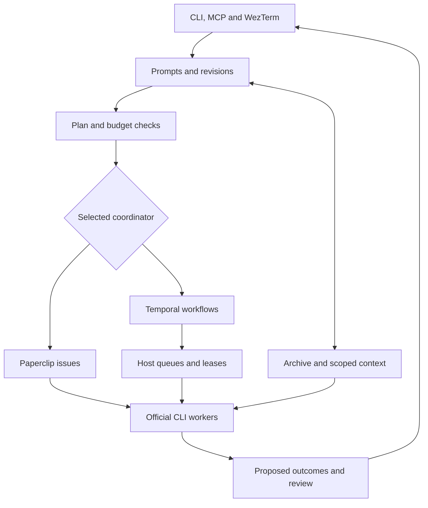
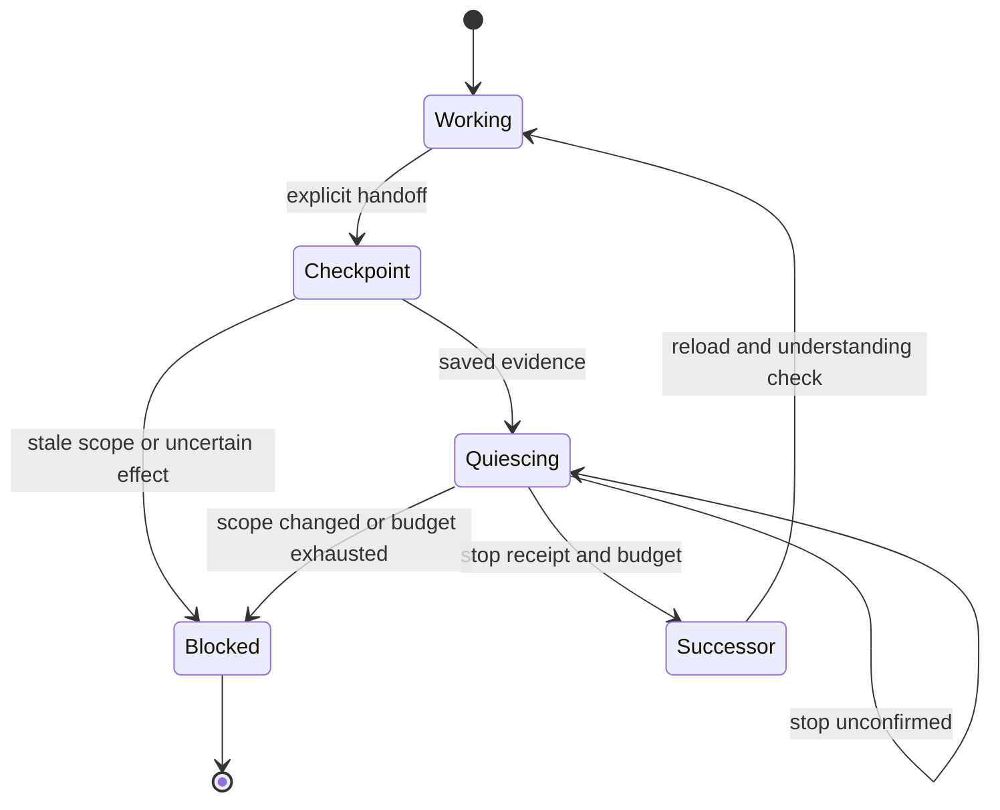

# Architecture

Workbench owns saved intent, context, review and terminal presentation. Exactly one coordinator owns agent execution: **Paperclip by default, or the optional Temporal backend**. Selecting Temporal does not start a second scheduler beside Paperclip. Local language checks are explicit operator commands, not another agent scheduler.

## Ownership

| Concern | Owner | Durable representation |
|---|---|---|
| Intent and project scope | Workbench | Original prompts, client-key receipts, request revisions, group/reopen links and deliverable criteria |
| Plans and admission | Workbench | Saved DAG, qualified model profile, pinned procedures, explicit budgets and outbox |
| Agent execution | Selected coordinator | Paperclip projects/issues/runs **or** Temporal workflow history and activities |
| Multi-host admission | Workbench control service | Named queues, project/workspace mappings, host credentials and fenced leases |
| Context | Local archive; optional adapters | Original bytes, extracted-text hashes, coverage, assertions, source authority and supersession |
| Conversation and editable memory | LCM and Basic Memory adapters | Explicit project bindings; no unrelated chat-directory scan |
| Retrieval and derived memory | QMD; optional Hindsight/OpenViking | Scoped collections or managed copies with readback/deletion receipts |
| Fresh-context handoff | Workbench protocol plus selected coordinator | Checkpoint generations, cumulative budgets, uncertain effects and process-stop evidence |
| Local test/build execution | Execution packs | Private source copies, reviewed argv plans, bounded process results and artifact hashes |
| Acceptance and presentation | Workbench | Outcome/review records, obligation links, immutable exports and persistent terminal views |

## Requests and execution

Ingress commits a client-key receipt before dispatch. Different keys remain distinct prompts. Explicit project/reply links take precedence over exact project-name matching. Task classification and grouping suggestions are lexical policies, not semantic understanding. Grouping requires an explicit compatibility decision and preserves the original requests and their acceptance criteria.

Amendments advance the revision and carry deliverable criteria forward as pending. A grouped child's amendment updates its parent in the same transaction; it does not create duplicate independent work. Withdrawing a member preserves surviving demands and parent-specific amendments. Reopening creates new work with copied criteria and historical lineage. Nested request groups are rejected. Ambiguous ownership in old group records blocks a scope rewrite instead of guessing which requirement to remove.

Paperclip delivery validates the current plan, model qualification, procedure hashes and **all** execution packets before creating a remote project, agent or issue. Dependencies dispatch in topological order. A short bridge lock serializes local admission, while independent issues can execute concurrently. Role slots keep parallel researcher branches distinct. Stale, accepted or cancelled scope cannot start new work. Per-plan runtime limits may narrow configured limits; they cannot increase them.

Temporal uses the real optional Python SDK, deterministic workflow IDs and per-host activity queues. Independent DAG nodes can run concurrently; dependent nodes receive predecessor results. An actual queue poller and fresh heartbeat are required for admission. Each worker has a local qualified model profile and process-receipt directory. Remote workers call the host-scoped control API; they do not share the controller's SQLite file. A host registration is not proof of a running model.

The backend selection fence blocks changes while running requests, delivery, active leases or uncertain executions remain. This is a single-controller guard, not distributed consensus. A timed-out lease stays uncertain and occupies capacity until reconciled. There is no automatic duplicate execution on another host. Fleet usage aggregates reported CLI counters by request, node and generation while keeping missing/conflicting data unknown; it does not invent provider cost, subscription balance or host CPU/memory telemetry. See [runtime contracts](RUNTIME_BACKENDS.md).

## Context handoff

Paperclip continuation requires its cancellation acknowledgement before a fresh-session wakeup. Temporal continuation cancels the node activity and requires the matching prior process-stop receipt before admitting a new generation. A terminal coordinator status alone does not prove that an OS process stopped.

Handoff is explicit: the system does not detect every provider's exact remaining context window or guarantee recovery from every context-limit error. Checkpoints retain requirement hashes, artifacts, unresolved work and generation/budget data. Repeated artifact fingerprints stop no-progress loops. Temporal node rollovers currently share the request checkpoint sequence, so simultaneous node rollovers require coordination.

Persistent context can grow on storage, subject to disk and retention limits. Each model input remains finite. Retrieval, original-source expansion and corpus coverage are separate operations; a relevant search result does not establish that the whole corpus was reviewed.

## Current bounds

| Area | Current bound |
|---|---|
| Default execution policy | 6 agent slots, 8 checkpoint generations, 3,600 seconds, child depth 2 |
| Default packet / writing budget | 24,000 characters per execution packet; 600 words for advisory outcome lint |
| Scoped retrieval packet | 100–1,000,000 characters; omitted sources remain visible |
| Fleet registration / leases | Capacity 1–1,024 per host, reserve below capacity; 10–300 second leases; heartbeat freshness 60 seconds |
| Execution workspace | At most 10,000 files and 100 MiB; excluded secrets, dependencies and build outputs are not copied |
| Local test/build process | 0.1–600 seconds; 256 bytes–8 MiB captured output; optional 64–16,384 MiB virtual-address limit |
| Optional context backend | 1 MiB source text; 2 MiB request; 4 MiB response; 1–100 recall results; 1–120 second timeout |
| Terminal tables | Up to 200 requests/outcomes after project and text filters; details are separate from logs |

These are configurable policy or adapter bounds, not measured fleet throughput or tokenizer-exact limits. Workspace copies and process limits are not an OS sandbox. Distributed shared-filesystem locking, automatic host provisioning and a global CPU/memory scheduler are not provided.

## Evidence and outcomes

Original bytes and extracted text are verified when reopened. Sources retain authority, supersession and explicit contradictions. Optional Hindsight/OpenViking copies require separate configuration and write authorization; their derived recall is linked to accessible originals and remains review-required. Copying, retrieval, deletion and backend/model qualification have distinct receipts. Local purge does not erase remote backups or exported copies. See [context backend contracts](CONTEXT_BACKENDS.md).

Citation checks establish passage presence and source integrity, not entailment. An outcome can satisfy one deliverable while the request remains open for others. Only acceptance of all current-revision criteria closes the request. Revoked or corrupt evidence from an already accepted deliverable blocks later completion. Reviewer identities are caller-supplied audit labels; they are not cryptographic or OS isolation.

HTML and Markdown exports include every accepted current deliverable, with drafts and incomplete scope clearly labelled. JSON retains historical records. Exports escape model/source text and are immutable snapshots. Plan DAGs, artifact manifests and local language checks provide inspectable evidence; none proves that a generated website, mobile app or research report meets its intended purpose.

The old Olympus runtime is not part of this architecture. Cloud tests and native WezTerm captures do not authorize retirement of a customized user installation: target-host qualification and the reviewed migration procedure still apply.
