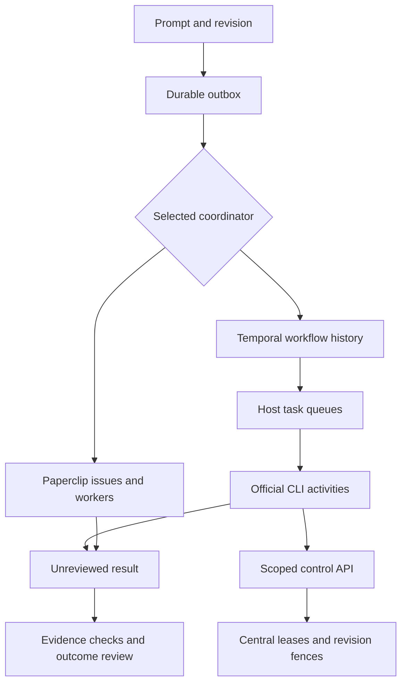

# Runtime backends and worker fleet

Choose **one** coordinator for an installation. Paperclip and Temporal are alternative execution backends; they must not schedule the same request together. The Workbench outbox records intent. The selected coordinator owns the execution graph. Workbench keeps requirements, checkpoints and reviewed outcomes.



## What is implemented

| Capability | Behavior and boundary |
| --- | --- |
| Coordinator selection | `coordinator.kind` selects `paperclip` or `temporal`. Switching is blocked while running requests, in-flight delivery, active leases or uncertain executions remain. This is a single-controller fence, not distributed consensus. |
| Temporal execution | The real Python SDK submits deterministic workflow IDs, a bounded dependency graph and explicit activity queues. Activities in each independent graph layer can run concurrently. Dependencies receive their predecessor results. |
| Missing worker | Dispatch requires a recent host heartbeat and an actual activity poller on its configured queue. A host registration alone does not qualify a worker or a model. |
| Model invocation | Workers run the official Codex or Claude CLI using a locally qualified profile. Subscription mode removes API-key environment variables and uses the CLI's existing sign-in. API profiles retain their configured environment. Credentials are not extracted or copied. |
| Idempotency | Workflow identity is request ID plus revision; the input hash must match. Worker receipts include node and generation. Uncertain receipts block replay. Completed execution still requires outcome review. |
| Restart recovery | A fresh controller can describe existing workflow IDs and recover their durable results. Durable process receipts prevent an activity from blindly launching a second CLI after a crash. Uncertain OS processes require reconciliation. |
| Explicit fresh-context handoff | `continuation.checkpoint` followed by `lifecycle.request` requests a fresh activity for one node. The workflow cancels that node, waits for activity cancellation, and passes the checkpoint to the next generation. Central admission requires a matching prior process-stop receipt. Iteration and cumulative time budgets apply. |
| Cancellation | A cancellation request is reported separately from stopped work. The activity terminates its process group and records the observed exit. A terminal Temporal status alone does not release an uncertain fleet lease. |
| Fleet admission | Named hosts have distinct queues, explicit project/workspace mappings, declared harness capabilities, capacity, and reserved interactive slots. Expired leases become uncertain and retain capacity. |
| Remote workers | A worker has its own local profile and process-receipt directory. It accesses central admission, current revisions, renewals and releases through a host-scoped HTTP interface. It does not share the controller's SQLite file or operator token. |
| Workspace writes | Each host serializes writers to a mapped workspace; different project directories can run concurrently. Distributed shared-filesystem locking is not provided. Give each host a separate checkout and use normal review/merge integration. |
| Terminal evidence | Fleet status exposes liveness, occupied capacity and uncertain leases without token hashes. Workflow observations expose node generation and execution state. Results are proposed for review, never automatically accepted. |

## Local setup

Install the optional SDK in the same environment as Workbench:

```sh
python -m pip install 'temporalio==1.35.0'
```

Install the official [Temporal CLI](https://docs.temporal.io/cli/setup-cli), then run a persistent local development server:

```sh
temporal server start-dev --ip 127.0.0.1 --port 7233 \
  --db-filename /absolute/private/state/temporal.sqlite --headless
```

The development server is for local development. It is not a hardened production service. A production remote Temporal service needs TLS and an appropriate deployment/authentication configuration.

Set the installation's `config.json` coordinator:

```json
{
  "kind": "temporal",
  "target": "127.0.0.1:7233",
  "namespace": "default",
  "task_queue": "awb-control",
  "host_id": "local"
}
```

Keep the rest of the configuration, including explicit models and budgets. Sign in with the official CLI, add a profile and run the Workbench profile probe. A successful `login status` command alone does not pass this probe; a successful assistant result containing the canary is required.

Register a host with an existing project ID and the **worker's** absolute project path:

```json
{
  "action": "fleet.register",
  "args": {
    "host_id": "local",
    "name": "Local workstation",
    "task_queue": "awb-local",
    "capacity": 4,
    "interactive_reserve": 1,
    "capabilities": ["codex"],
    "workspaces": {"PROJECT_ID": "/absolute/path/to/project"}
  }
}
```

Send the JSON using `awb --home /absolute/state request -` with standard input. Registration returns a host token once. Save that token in a private regular file with mode `0600`; do not put it in the repository, shell command arguments, screenshots or documentation.

Start a worker in another terminal pane:

```sh
awb --home /absolute/state temporal-worker \
  --host-id local --token-file /absolute/private/host-token
```

Then run the Workbench service/TUI or submit a request and tick the selected coordinator. `coordinator.health` checks the Temporal service; `fleet.status` and actual execution results establish separate parts of readiness. The first model call can still fail despite healthy queues, so its result is never assumed.

## Remote host setup

1. Register the remote host centrally with a unique activity queue, capacity and project paths as they exist on that host.
2. Install Workbench, the SDK and the official model CLI on the worker. Qualify its local model profile. Public profile ID, harness, model, effort and authentication mode must match the dispatched profile.
3. Configure the worker's Temporal connection to the same namespace and control queue. Non-loopback Temporal targets require TLS. Optional `client_cert`/`client_key` paths enable mTLS; `api_key_env` names an environment variable without embedding its value in configuration.
4. Expose the central Workbench control API through an authenticated tunnel to its loopback service, or a correctly configured HTTPS reverse proxy. The worker client rejects plaintext non-loopback URLs, embedded URL credentials and redirects.
5. Start the worker with its separate state directory and scoped credential:

```sh
awb --home /absolute/worker-state temporal-worker \
  --host-id remote-a --token-file /absolute/private/host-token \
  --control-endpoint http://127.0.0.1:18765
```

The example control endpoint is the **worker-side** loopback end of a secure tunnel. Temporal service TLS and the control tunnel are separate connections. Workbench does not install a VPN, provision cloud machines or copy workspaces automatically.

`POST /worker` accepts only `heartbeat`, `status`, `request_state`, `admit`, `renew` and `release`, authenticated by the registered host token. A worker sees only its own registration and mapped request state. It cannot register hosts, spend reserved interactive slots, issue operator commands or renew another host's lease. The controller remains the only database writer for fleet decisions.

Use host-specific queues and separate checkouts. A task does not automatically move to a second host when its lease expires: the first process may still be running. A verified stop receipt is required before a new generation. Loss of the control connection stops renewal and causes a worker to stop its process; a controller that did not receive the stop receipt conservatively retains the uncertain lease.

## Context handoff and recovery

The current handoff is explicit. It does **not** inspect a provider's exact remaining context window or guarantee uninterrupted progress across every harness error. Save a current checkpoint with artifact/source hashes before requesting rollover. Old requirements, uncertain effects, stale generations, missing process-stop evidence and exhausted budgets block continuation.

A Temporal workflow restart replays its recorded history. That durability does not make external CLI effects exactly once. After an abrupt worker/OS crash, inspect the retained `worker-runs` receipt and process identity before releasing its lease. Reusing the same lease generation or silently freeing capacity after a timeout is prohibited.

A node's rollover generation currently shares the request checkpoint generation sequence. Concurrent independent node rollovers need separate checkpoint coordination; an out-of-sequence node request is rejected. Workflow history growth is bounded by the configured graph/iteration limits; this backend does not claim infinite history or unbounded context. Persisted source context and bounded retrieval remain separate from the model's finite input window.

## Tests and evidence

Run the deterministic admission/selection tests with the normal test suite. To run the actual local Temporal service tests, provide an installed official executable:

```sh
AWB_TEMPORAL_SERVER_BINARY=/absolute/path/to/temporal \
  python -m pytest tests/test_runtime_backends.py -q
```

The real-service tests start the official Temporal devserver with a temporary SQLite database and use the actual SDK, workflow replay, queues, cancellation and workflow signals. Their activities are explicitly **deterministic fixtures**. They establish scheduler/control behavior; they are not LLM, semantic-quality, production-deployment or physical multi-machine qualification.

| Test | Evaluation |
| --- | --- |
| `test_temporal_real_service_dag_idempotency_recovery` | Parallel independent nodes, dependency ordering, one execution per identity, fresh-controller result recovery. |
| `test_temporal_real_service_cancellation_stops_activity` | Cancellation requested is distinct from activity stop acknowledgement. |
| `test_temporal_real_service_checkpoint_rollover` | Valid checkpoint, cancellation, prior stop receipt, fresh generation and freed capacity. |
| `test_temporal_separate_worker_store_over_http` | Separate local worker database, real Temporal queue and authenticated HTTP admission; no shared central requests/host tables. |
| `test_worker_control_real_http_host_auth_and_scope` | Actual HTTP route, scoped token, lease lifecycle and rejected escalation. |
| Fleet contract tests | Heartbeat, project/harness scope, secret redaction, reserved capacity, duplicate ownership, expiry, wrong stop identity, stale revision and backend switch fences. |

Real Codex/Claude execution, actual research quality, production TLS credentials and physical multi-host operation need their own retained evidence. A fixture pass must not silently mark those gates passed.

## Primary references

- [Temporal Python SDK](https://github.com/temporalio/sdk-python)
- [Python client API](https://python.temporal.io/temporalio.client.Client.html)
- [Workflow handles](https://python.temporal.io/temporalio.client.WorkflowHandle.html)
- [Python cancellation behavior](https://docs.temporal.io/develop/python/workflows/cancellation)
- [Testing workflows and activities](https://docs.temporal.io/develop/python/best-practices/testing-suite)

## Reported usage and capacity

`fleet.usage` reads token counters from stored node results and fleet stop receipts. The terminal view can show these beside configured and occupied worker slots. It never estimates a subscription allowance, price, bill, CPU percentage or memory use: those fields remain `null`.

The CLI adapter reads the final `turn.completed.usage` event from one Codex invocation, or `result.usage` from one Claude invocation. It does not add repeated terminal events or intermediate snapshots. Counters are retained in successful receipts and, when present, failed/cancelled process-stop receipts. Raw provider output stays in the private worker directory.

| Normalized counter | Accounting |
| --- | --- |
| `input_tokens` | Total reported input. Codex's input already includes cache reads. For Claude, total input is calculated only when uncached input, cache-read and cache-creation counters are all present. |
| `output_tokens` | Reported output count. |
| `cached_input_tokens` | Cache-read portion of input; do not add it again. |
| `cache_write_input_tokens` | Cache-creation portion of input, when supplied; do not add it again. |
| `reasoning_output_tokens` | Reported reasoning portion of output, when supplied; do not add it again. |

Missing fields remain unknown, including reasoning counts that a harness does not expose. Negative values, booleans, strings and inconsistent subset counts are rejected as malformed counters. Zero is retained only when explicitly reported. Claude result usage may exclude nested subagents or underreport interrupted work; this report does not label such counters whole-company billing totals.

Aggregation identifies work by request, revision, node and worker generation. A workflow result and its stop receipt count once. Repeated observation of the same stored result adds nothing. Historical revisions remain included because their execution consumed resources; optional `project`, `request_id` and `revision` filters narrow the report. Conflicting counters become unknown. Explicit fixture results are excluded.

The response includes `totals`, per-field known/unknown record counts in `metrics`, coverage for incomplete executions and missing prior generations, and a revision breakdown. `coverage.input_output_complete` means the two normalized counters are present for those records; it does not mean every optional counter or all external activity was observed. Slots describe configured admission capacity, not measured compute utilization. This query does not expire leases or modify execution state.

The usage tests use documented event-shaped fixtures, including malformed data, absent fields, duplicate events, repeated observations, prior revisions and conflicting receipts. They test accounting behavior and are not language-model qualification.

Accounting references:

- [Codex CLI event schema](https://github.com/openai/codex/blob/main/sdk/typescript/src/events.ts)
- [Codex input/cache relationship](https://github.com/openai/codex/blob/main/codex-rs/tui/src/token_usage.rs)
- [Claude input/cache accounting](https://platform.claude.com/docs/en/build-with-claude/prompt-caching)
- [Claude result-usage scope](https://code.claude.com/docs/en/agent-sdk/cost-tracking)
