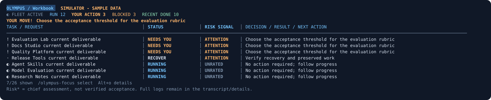
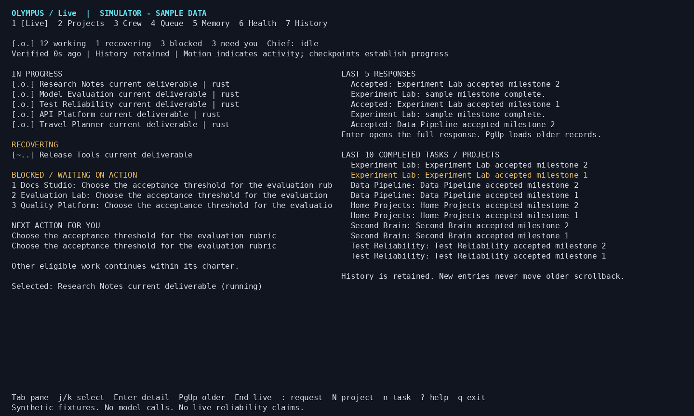

# Olympus: a durable command room for Firstmate

Olympus adds a Rust coordinator and a Pi terminal to this Firstmate fork.
The coordinator retains projects, requirements, attempts, messages, evidence and recovery obligations independently of model conversations.
The current release is an installable engineering preview, with live model dispatch disabled in a new home.

## Install and try it

Supported platforms are Linux and macOS, with WSL2 as the Windows path.
The source installer requires Git, curl, tar and a native C build toolchain, bootstraps an isolated Rust toolchain if needed, installs private Node 24 when Node 22+ is absent, and installs Pi 1.4.0 plus TypeBox 1.4.3 under the chosen prefix.
It does not require sudo, alter shell startup files, create provider accounts or copy provider credentials.
Allow several minutes for the first source build.

```bash
curl -fsSL https://raw.githubusercontent.com/balrajOla/firstmate/codex/olympus-control-room/bin/olympus-install.sh | bash
export PATH="$HOME/.local/bin:$PATH"
olympus init
olympus start
olympus ui
```

To install a reviewed local checkout, run `bash bin/olympus-install.sh --source "$PWD" --prefix "$HOME/.local"`.
For a reproducible revision, check out the desired commit before running the local installer.
An upgrade replaces application binaries and assets; it does not erase or silently restart an existing coordinator.
Take a verified backup, stop the coordinator, install, then start it.
Opening schema 1 or 2 applies additive migrations through schema 3 transactionally.
An older binary refuses schema 3; rollback uses the pre-upgrade backup in a new home.

Use a separate home for the sample portfolio.

```bash
olympus --home "$HOME/.local/share/olympus-demo" demo
olympus --home "$HOME/.local/share/olympus-demo" start
olympus --home "$HOME/.local/share/olympus-demo" ui
```

The demo creates 20 clearly labelled synthetic projects, 12 working tasks, one recovery, three blockers, five recent responses and ten recent completions.
It makes no model calls and does not establish real harness reliability.
Closing the terminal leaves the coordinator running.

## Work through Pi

```bash
balraj-work
# In Pi: /olympus-focus to choose the work you want to discuss
# Optional: /olympus-auto on
```

The daily entry point opens one Pi terminal with a compact, decision-first workbook above the ordinary chat editor.
The default `tasks` view uses at most 35 percent of the terminal, capped at fourteen rows, so the conversation remains visible.
Its table separates task/request, status, risk signal and decision/result/next action; narrower panes retain status and action columns instead of squeezing every field into unreadable text.
A highlighted next-move strip prioritizes an observed operator action or clearly labeled chief suggestion.
Queued work, user actions, unverified sessions and independently accepted results have separate statuses and colors.
Raw API payloads, code blocks and routine working notes are omitted from the workbook; tool responses and action references are collapsed in the transcript unless Ctrl+O expands them.
The complete model context, stored records and full detail views remain intact.
The chief publishes a bounded `olympus_summary` assessment with an outcome, actual decision or None, next action and risk basis.
Risk labels marked with `*` are chief assessments, not verified task acceptance or calibrated risk probabilities, and cannot downgrade a native runtime conflict.
Unrated risk remains unrated instead of defaulting to low.
Indeterminate progress animates only a live local reply or fresh worker activity; an attention marker pulses for a current operator action.
Stale worker observations freeze progress animation, and no progress percentage is invented.
Set `OLYMPUS_REDUCED_MOTION=1` before launch for static status and attention indicators.
Your conversation and input stay available while the panel refreshes, and existing projects, results and recovery obligations come from the same saved coordinator home.
Use `/olympus-panel tasks` for this compact view.
The optional `live` view uses the same dashboard renderer as the standalone terminal and the GitHub screenshots, rather than a separate compact summary.
It includes the ten dashboard tabs, live/recovering/blocked work, recent responses and completions, and the next-action queue.
It occupies approximately 65 percent of the terminal, capped at 32 rows, while keeping the Pi conversation and normal input available in the same terminal.
Very short terminals show the dashboard header and controls; narrow terminals use the shared dashboard's single-column layout.
The screenshots are explicitly labeled synthetic sample data, whereas your workstation displays your saved projects and actual results.
Cyan identifies the panel and explicit focus, green identifies work and results, amber identifies actions, and red identifies disconnected observations.
Text labels carry the same meaning so color is never the only status cue.
Use Alt+1 through Alt+9 and Alt+0 to change dashboard tabs without replacing your typed draft, or name a tab with `/olympus-panel`.
The larger dashboard tabs are live, projects, crew, queue, memory, health, history, today, week and recurring.
The workbook preview below comes from the production segment renderer and an explicitly synthetic portfolio; the larger Live/Today screenshots illustrate optional full dashboard layouts.


Use `/olympus-panel off` to reclaim space and `/olympus-panel on` to restore the dashboard.
Use `/olympus-focus` to select a task or project with the arrow keys and Enter, or provide its exact ID; `/olympus-focus clear` clears the selection.
Task rows have stable conversation-local references such as #1 and #2; reordering never changes an assigned number.
Use `/olympus-focus #2`, or write `inspect #2` or `compare #1 and #2` in a prompt; the chief receives the corresponding exact task records and uses full IDs with the broker.
References survive reload and resuming that Pi conversation, are never reused within it, and do not grant task cancellation or acceptance authority.
Starting a separate conversation may assign a fresh reference set, so use the numbers displayed in that conversation.
An unbound old attempt is labeled RECONCILE / TRACKING rather than implying a current application authentication error.
Cached observations are labeled disconnected and never presented to the model as fresh evidence.
Use Alt+o or `/olympus` for full-screen interactive detail, then Escape or `q` to return to the conversation and preserve your typed draft without opening a separate window.
Each user turn also includes the exact UI controls, so the chief can explain the installed dashboard instead of directing you to a separate terminal.
`olympus chief` also loads the docked panel.
The portable installer includes the command and panel assets; `balraj-work --help` owns launcher options and `--check` provides a model-free startup check.
The launcher uses an existing account-aware Pi executable when one is available, otherwise the bundled Pi remains the fallback.
Provider login is still required on a new machine; installation never copies credentials or automatically enables work.

The command creates a durable chief identity once, loads the extension, and gives its tool a scoped credential.
Pi uses your existing provider configuration or its own login flow.
`OLYMPUS_PI_COMMAND` can name an exact account-aware Pi executable for chief startup; it is never evaluated as shell text.
Extra Pi arguments follow `--`, for example `olympus chief -- --help`.
The extension never falls back to the operator credential for model tool requests.
The workstation chief has normal Pi shell, file, search and configured MCP tool access as well as Olympus tools.
It is not a broker-only conversation: simple desktop requests run directly with the available tools and are verified before being reported as done.
Simple desktop actions, such as opening a browser URL, are performed directly and verified through the tool rather than becoming repository-backed worker projects.
Substantive independent project work still uses Firstmate workers.
Operator-only changes through `olympus_control` ask for an explicit confirmation; shell tools run with the user's account permissions and are not an OS security boundary.
`olympus_task_control` can inspect, stop, cancel or recover an exact task, including a displayed #N reference, within the connected Olympus home.
It uses Firstmate's supported generation-bound stop and a fresh dead observation before cancelling a bound worker, preserves work, and refuses ambiguous or uncertain identities instead of raw-killing processes.
Routine task lifecycle commands use operator-backed authority without requiring the user to run the evidence chain manually.
Unknown risks can be investigated and mitigated with the normal toolset, but permissions never turn an uncertain effect into fabricated stop evidence.
Queued work requires no fabricated stop proof; an unbound attempt must have every launch proved refused before execution before it can be cancelled or recovered.
The summary tool changes session presentation only; it cannot accept work, alter task status, or control a runtime.
Workers still require separate OS isolation for a strict system-wide security boundary.
The interactive dashboard uses the operator connection for your own manual actions.
The chief can perform ordinary workstation actions directly and submit project work or recurring tasks.
High-impact operator configuration and service controls are confirmed interactively, and runtime evidence must come from actual observations rather than a model-generated claim.

Automatic chief wakes are explicit: `/olympus-auto on`, or `olympus chief --auto`.
They coalesce unchanged conditions, wait at least 30 seconds between turns, never interrupt a busy turn, and stop after ten automatic turns until you renew the budget.
The daemon continues when the chief pauses, hits a budget, exits or loses context.
Project automation runs in the coordinator and continues after the chief session ends or reaches its wake budget.
The optional interactive Pi conversation is not restarted automatically; reopening `olympus chief` reuses its durable identity and retrieves current project context.

## Worker execution checks

The coordinator's version probe has a bounded ten-second budget rather than refusing an otherwise valid launcher after three seconds.
An optional configured account bridge can use the installed `gateway-launch.py` helper; its version-only path reads the same pinned package metadata that Pi uses for VERSION, without loading the full SDK.
The helper preserves isolated worker discovery while restoring normal context, skills and configured MCP support for the interactive chief.
The helper's header owns bridge, prefix and Node overrides; no provider code or credentials are copied into the repository.
A prepared launch or allocated attempt is not a running worker; the chief must check the launch receipt and native runtime observation.
Do not retry a refused operation unchanged or fabricate a native-generation receipt to free capacity.

## Parallel intake and context continuity

The chief has one coherent Pi conversation, but request intake is independent of that conversation's current model turn.
`/request <text>` journals and submits new work immediately, including while the chief is streaming or compacting.
Ordinary text submitted while the chief is busy is captured as an independent durable request when `OLYMPUS_PARALLEL_INTAKE=1`, the workstation default; attachments retain Pi's normal queue behavior.
Use `/steer <text>` when you mean to change the current chief turn rather than create another request.
A confident match groups follow-up work under an existing project with retained context; an ambiguous match is preserved for `/requests` to choose a project rather than silently merging work.
A task number in the new request supplies project context, not permission to overwrite that task.
`/amend #N <full revised requirements>` explicitly updates the exact task through optimistic version checking and retains earlier versions and results.
An accepted receipt means durable intake, not a started worker or a completed result.
Accepted work enables a bounded coordination wake when the chief becomes idle; existing project automation can continue workers independently of the chief conversation.
Worker concurrency still obeys configured admission, provider limits and machine resources; this is not simultaneous mutation of a single model transcript or an unlimited-resource claim.

Pi's automatic compaction should remain enabled, with reserve tokens chosen for the selected model's actual context window.
The optional `chief-quality.example.json` profile demonstrates the installed large-context GPT chief at max effort, an early model-specific compaction threshold and delivery of all native steering/follow-up messages.
It is a quality-oriented configuration, not proof of an objectively best model, and requires that model and effort to be supported by the authenticated provider.
`/context-refresh` requests a real Pi compaction at a safe idle boundary; it does not restart workers or erase tasks.
Before compaction, a bounded coordinator checkpoint is appended as session metadata; intake receipts, task numbers and authoritative work remain in the durable coordinator/branch records.
A failed refresh is reported without discarding queued work, and uncertain operations are never replayed as a context-reset shortcut.
No implementation promises that a provider will never report overflow; Pi's bounded overflow recovery and durable record retrieval are the fallback.

## Workstation authentication checks

The authenticated Pi launcher setting is implemented in the Olympus CLI, not in the widget.
Install the CLI, launcher and UI assets from the same reviewed source revision; copying newer widget files onto an older CLI does not add that launch support.
`balraj-work` selects an existing account-aware Pi executable through `OLYMPUS_PI_COMMAND` and suppresses the self-update check for the installer-managed workstation session.
Provider credentials remain in their existing native store or launcher environment.
A widget appearing does not prove model authentication; the GUI-only simulator test deliberately submits no model requests and is not an authentication check.
With an installed, already-authenticated workstation, `OLYMPUS_AUTH_LIVE=1 bash tests/olympus-auth-live.test.sh` checks a fresh login-shell command, its resolved executable and a separate user wrapper when present.
It requires the selected model to appear in Pi's authenticated model list and checks that Olympus commands registered, without submitting a model prompt or printing credentials.
The guard's header owns shell and executable overrides.

## WezTerm compatibility

The Pi widgets use Pi's terminal renderer, not a separate terminal process or browser window.
The real WezTerm GUI check covers the compact task view, all ten dashboard tabs, ANSI colors, Unicode paste, pane-split resizing and returning from full detail with an unchanged draft.
Use the opt-in guard documented in [verification](olympus-verification.md#wezterm-widget-verification-2026-11-04) to check an installed WezTerm build.
On macOS, physical Option/Alt composition depends on your WezTerm configuration; `/olympus` and `/olympus-panel` provide the same functions without changing global keybindings.
The automated guard verifies Meta's terminal byte sequence, not physical keyboard composition.
Your existing fonts, colors, leader shortcuts and terminal configuration are left unchanged.

## Your daily workflow

| You do | System behavior | Where to inspect |
|---|---|---|
| Give a request | `intake.preview` identifies explicit IDs or project aliases and returns candidate matches with reasons | `:` previews and submits the route; ambiguity opens a project choice |
| Add related work | Chief creates a task in the selected project or proposes a versioned amendment | Projects; task detail |
| Change requirements | `task.amend` requires `expected_version`; old output becomes stale until the owner acknowledges the new version at a safe checkpoint | Task detail and requirement history |
| Ask for a team | `team.create` registers a captain and up to eight role-specific identities without launching idle workers | Crew hierarchy |
| Run independent work | Claim atomically reserves capacity; `dispatch.plan` recommends a verified role-capable profile; `operation.prepare` records a runtime effect | Live; Health; operations API |
| Ask a bounded sub-question | Reserve the child first; native launch requires separately verified child support, otherwise use an independent Firstmate worker | Crew; child dependency in task detail |
| Discuss work between agents | Scoped durable mailboxes distinguish persisted, delivered, read and acted receipts | Message API; incidents for overdue delivery |
| Receive output | Preserve full result and code revision; independent quality review accepts only current evidence | Five recent responses; scrollable History |
| Find a blocker | Numbered queue includes owner, reason and next check; other admitted work continues | Queue |
| Resume after failure | Inspect canonical process evidence, reconcile effects, fence the old attempt, preserve its workspace and create the replacement generation | Queue; task attempts |
| Renew context | Pause, create an exact record manifest, fetch records individually, verify hashes and transfer to a successor after stopping the old runtime | Context API |
| Build a second brain | Record source-backed candidate or verified knowledge; superseded records remain on disk and in SQLite | Memory; local `vault/` Markdown |

The routing preview never silently merges projects or overwrites requirements based on similarity.
The intake matcher uses names, aliases and shared topic terms across active and completed projects.
A confident `intake.submit` creates a follow-up with retained context, reopens a completed project, and deduplicates an identical existing request.
An unmatched request creates a separate project and task, with the request as its initial charter.
No repository, account or execution permission is inferred; bind the new project with `olympus bind P-ID /absolute/path/to/repository`, then enable its verified execution policy.
Ambiguous matches require an explicit project; existing requirements change only through a versioned amendment with an exact task ID.
Use `olympus submit "Full revised requirements" --task T-ID --expected-version 2` to amend a known task.
Use `--new-project "Project name"` to force a separate project, or `--complexity routine|standard|complex` to override the disclosed text heuristic.
Requirement changes create durable owner and dependent-owner notifications; a full mailbox delays delivery without losing the amendment.
This is explainable lexical retrieval, not a validated semantic embedding model.
It can form sub-captains with `agent.create`, subject to scope, a maximum depth of four and bounded management spans.
Native children have a separate maximum depth of six and consume the same admission capacity as independent workers.

## Automatic project operation

After connecting an execution-enabled Firstmate home and verifying the installed worker profiles, enable each project once.
The project should have role-capable worker and quality-review profiles.

```bash
olympus auto P-YOUR-PROJECT
olympus submit "Continue the importer work with CSV support" --project P-YOUR-PROJECT --role rust
olympus agenda today
olympus agenda week
olympus outcomes P-YOUR-PROJECT
```

The coordinator assigns an eligible specialist, reserves room for independent review, prepares a launch, and advances the dependency graph as accepted results arrive.
Quality workers use `review.submit` to complete their review and accept or reject the exact producer revision together.
One failed review returns evidence to the producer.
After a second failure, a different verified profile may be selected; the coordinator requests a stop and requires matching fresh stop evidence before replacement.
If no eligible alternative or recovery budget remains, the task waits for a decision.
The total replacement budget remains two; each new attempt has one bounded rework opportunity.
Accepted evidence is captured automatically in the local second brain, with full source references.
`child.reserve` creates a scoped child identity, dependency and reservation; project automation launches that child as an independent Firstmate worker.
This portable route works through the selected verified profile and does not require vendor-native subagent APIs.
Vendor-native launch shims remain outside the verified implementation.

Four bounded bridge workers process runtime effects, prioritizing stop and message operations before launches.
The broker and observer continue independently when an external operation is slow.
Accepted dependencies enqueue a durable notification to the waiting owner; waiting on unfinished child work does not trigger a no-progress restart.
A mailbox notification asks its recipient to retrieve the full persistent message; transport success never impersonates the recipient’s read or acted acknowledgement.
Project automation does not authorize merging, publishing, changing provider accounts or bypassing Firstmate’s process controls.

Use `olympus auto P-YOUR-PROJECT --off` to stop new automatic assignments for that project.
Already running work remains visible and must be paused or stopped explicitly.

## Model choice and retained learning

`dispatch.plan` exposes the task class, candidate profiles, chosen effort, recorded outcomes and exclusion reasons.
Classification is an editable conservative text heuristic, not a calibrated prediction of task difficulty.
A profile declares supported roles and complexity classes; reasoning effort comes from its verified `effort_by_complexity` mapping, not a guessed vendor flag.
Profiles without complexity declarations remain eligible for routine and standard work only.
The exact profile configuration is pinned to each launched attempt, including model, harness version and capabilities.
Changing a profile invalidates its verification and prevents old evidence from scoring the new configuration.

Independent reviews and repeated-progress failures record source-linked lessons automatically.
One attempt contributes one outcome, with reworked acceptance distinguished from first-pass acceptance.
Routing uses the last 100 matching outcomes only after five samples for the same role, complexity and exact profile configuration; the current score assigns 1 to clean acceptance, 0.5 to acceptance after rework and 0 to failure.
That is an inspectable local policy, not a statistical guarantee that the chosen model is universally best.
Two failures on the same requirement version exclude that profile configuration for the next attempt and require complex-capable alternatives.
Amended requirements retain the old lessons but do not inherit their task-specific exclusion.
Operator-recorded `evaluation.record` entries remain audit evidence; unbound historical entries do not silently count as automatic quality measurements.

`learning.status` returns project-scoped lessons and outcomes; press `l` on a project or task to inspect them in the terminal.
Project context includes a bounded recent learning summary, while `task.get` retains complete lesson evidence.
This improves the harness's retained context and routing decisions; it does not fine-tune a model or prove that future quality has improved.

## Calendar and recurring work

Today and This week show due, overdue, active, recovering, blocked and completed tasks, with project filters and links to full records.
The week uses Monday through Sunday in the configured timezone.
Recurring jobs support daily, weekdays and weekly schedules.
The default timezone is Europe/London, configurable through `maintenance.configure`.
Create a job with `s` in the terminal or the action reference.

The calendar stores occurrences transactionally, coalesces missed runs after downtime, and waits when a previous occurrence is unfinished.
A fall-back clock hour runs once; a nonexistent spring-forward time advances to the next valid local minute.
Pausing a schedule prevents future occurrences without erasing its task history.
These are local coordinator jobs, not ChatGPT scheduled tasks.
The coordinator must be running; after downtime it reconciles missed occurrences when restarted.

Install a user service for restart after a coordinator crash and startup on login.
The service preserves the installing shell’s executable search path.

```bash
olympus service launchd --install
# Linux alternative:
olympus service systemd --install
```

The command saves a service definition, stops the existing coordinator cleanly, and activates the user service without sudo.
Omit `--install` to inspect the definition only.
A logged-out Linux user requires separately configured user-service persistence for work to continue after logout.

## Automatic recovery and backups

Project automation checks meaningful progress separately from contact.
After the configured no-progress deadline, it requests a stop and waits for fresh, matching process-generation evidence before replacing a worker.
Missing observations alone never allow replacement.
Recovery preserves prior workspaces and supplies the replacement with current requirements, previous attempts, results and verified knowledge.
There are at most two replacement attempts; unresolved external effects and human decision blockers remain visible for reconciliation.

The coordinator attempts a verified local backup daily, records success or failure in Health, and retries a failed attempt after five minutes.
A full workspace snapshot requires quiescent workspaces; the backup reports failure rather than silently omitting a changing workspace.
Change the interval or disable scheduled backups through `maintenance.configure`.
Backups remain under the home’s `backups/` directory and are not automatically deleted.
Offsite transfer still uses the explicit restic command below; automatic offsite restore has not been validated.
Restoration pauses schedules, disables automation and dispatch, revokes old credentials and discards stale stop evidence.

## Current terminal views

These images render the shared production view from the running installed simulator.
They are exact text/layout examples with synthetic tasks, not evidence of live model work.



[Animated activity](assets/olympus-live.gif) · [Today PNG](assets/olympus-today.png) · [Recurring PNG](assets/olympus-recurring.png) · [Project outcomes PNG](assets/olympus-outcomes.png) · [Learning PNG](assets/olympus-learning.png)

[Projects](assets/olympus-projects.svg) · [Crew](assets/olympus-crew.svg) · [Queue](assets/olympus-queue.svg) · [Memory](assets/olympus-memory.svg) · [Health](assets/olympus-health.svg) · [History](assets/olympus-history.svg) · [Today](assets/olympus-today.svg) · [This week](assets/olympus-week.svg) · [Recurring](assets/olympus-recurring.svg) · [Project outcomes](assets/olympus-outcomes.svg)

## Live terminal controls

| Key | Action |
|---|---|
| `1` - `7` | Live, Projects, Crew, Queue, Memory, Health, History |
| `8` / `9` / `0` | Today / This week / Recurring |
| `f` / `o` | Filter by the selected project / open its separate outcome report |
| `l` | Inspect the selected project’s retained learning and reviewed outcomes |
| `i` in Crew | Inspect the selected agent’s pending mailbox |
| `s` / `d` | Create a recurring job / set a task due date |
| `A` in Projects | Toggle that project’s automation policy |
| `Tab` | Focus live work, recent responses or completions |
| `j` / `k`, arrow keys | Select records or scroll a full response |
| `Enter` | Open the full response or structured record |
| `PgUp` / `PgDn` | Page detail; load older history |
| `t` | Cycle response, completed-task and completed-project history |
| `/` | Search retained history |
| `End` | Return to live; clear new-response badge |
| `N` / `n` | New project / new task wizard |
| `a` | Amend the selected task with optimistic version checking |
| `p` / `r` | Pause / resume the selected task or recurring schedule |
| `:` | Route a request; confident matches queue work, unmatched work creates a project, ambiguity opens a project choice |
| `Esc` / `q` | Back / detach |

Any fresh working task animates the fleet indicator even when the chief is idle.
Recovery has a separate indicator, and `--reduced-motion` retains textual status without motion.
The UI redraws locally at 250 ms and requests a snapshot once per second; animation does not call a model.
Cached state remains visible under disconnection but is explicitly marked stale and stops animating.
A heartbeat establishes contact, not useful progress.
The terminal sanitizes escape sequences from model output and adapts to an 80-column view.

## Enable real harnesses deliberately

Firstmate remains the owner of actual Claude, Codex, Muse and Pi process lifecycle.
Olympus uses `fm-brief.sh`, `fm-spawn.sh`, `fm-send.sh`, `fm-control.sh` and `fm-fleet-snapshot.sh`; it does not infer process truth from arbitrary pane text.
Use your configured Firstmate home, selected backend, installed harnesses and existing account permissions.
The fork's normal Firstmate lock, dispatch-profile and backend rules continue to apply and may refuse a command.

```bash
olympus doctor --firstmate-root /absolute/path/to/firstmate
olympus connect --firstmate-root /absolute/path/to/firstmate \
  --firstmate-home /absolute/path/to/your-firstmate-home
olympus observe
```

Connection initially enables observation only.
A registered profile is unverified until the operator records a real launch, message, interrupt, resume and stop conformance run for its exact harness version.
Native-child capability additionally requires child launch, peer messaging, stop and budget evidence.
Register and verify through the [action contract](olympus-api.md), then enable the coordinator's `dispatch_enabled` setting and reconnect with `--enable-execution`.
The bridge checks the installed version again before every effect.
A profile's exact version string must match the harness's complete `--version` output, as reported by `olympus doctor`.
Uncertain effects are never replayed automatically.

Claude, Codex and Muse have not been exercised with authenticated live sessions in this delivery environment.
Muse's exact installed product and CLI must be confirmed locally before a profile can be used.
Native-child interoperability is capability-gated, not claimed to work uniformly across vendors.

## Recovery and context

| Failure | Bound and response |
|---|---|
| Coordinator crash | SQLite WAL, full synchronization, durable request receipts and OS restart; accepted writes survive process restart |
| Two coordinators | Exclusive lock prevents two local daemon owners |
| Missed heartbeat | After 30 seconds, state becomes unknown; ownership and capacity stay reserved |
| Exact fresh runtime observation | Working state and matching Firstmate spawn generation can renew contact; endpoint existence alone cannot |
| Repeated no-progress checkpoint | Three repeats block the attempt; one changed-plan resume is permitted before escalation |
| Worker replacement | Operator confirms stopped runtime and reconciled effects; at most two replacements per task |
| Lost runtime-operation reply | Persist uncertainty before execution; require reconciliation instead of replay |
| Overloaded mailbox | 128 pending ordinary messages, 32 extra critical slots, coalesced persisted progress updates |
| Missed message deadline | Durable dead-letter record and visible incident |
| Chief overload | Bounded 20-project briefing and five exceptions, direct peer messages, scoped captains and wake budget |
| Context renewal | Required-record hashes, current version, workspace identity and all pending obligations must match before ownership transfer |

The system preserves recorded source context, not unrecorded model thoughts.
Hash completeness proves record fidelity; it cannot prove a successor understood every nuance.
No implementation can promise zero failures or zero semantic context loss.
The [verification record](olympus-verification.md) separates tested behavior from remaining release gates.

## Back up, restore and supervise

```bash
olympus backup create /absolute/path/to/new-snapshot
olympus backup verify /absolute/path/to/new-snapshot
olympus backup restore /absolute/path/to/new-snapshot /absolute/path/to/new-home
olympus --home /absolute/path/to/new-home start
```

Quiesce recorded workspaces before a full backup.
The backup includes a consistent SQLite snapshot, Markdown vault, Git bundles, binary patches and tracked plus nonignored untracked files for recorded workspaces.
A changing, active, unreadable, oversized or symlinked workspace refuses the snapshot rather than silently omitting it.
Gitignored files and external provider secrets require a separately configured backup.
Checksums detect corruption; they are not an authenticity signature against a malicious backup author.

Restore requires a new destination, disables dispatch, revokes agent credentials, invalidates profile verification and marks active ownership unknown.
Inspect archived workspaces and reconcile old machines before reconstructing them in a new location and resuming.
The preview does not automatically rewrite workspace paths, log into providers or resume restored external effects.
For encrypted offsite retention, configure Restic and run `olympus backup offsite /absolute/path/to/new-snapshot`.
Local scheduled backups are implemented; automatic offsite transfer and disaster-recovery failover remain release work.

To survive login or host restarts, print and inspect a service definition, then install it with your OS service manager.

```bash
olympus service systemd
olympus service launchd
```

Service installation and enablement are explicit operator actions.
The preview is one local coordinator with SQLite, not a distributed consensus system.
A same-user unrestricted shell can read same-user files or kill same-user processes; strict agent isolation requires a dedicated OS account, container or VM policy.
The broker's scoped credentials enforce its API boundaries but do not create an OS sandbox.
